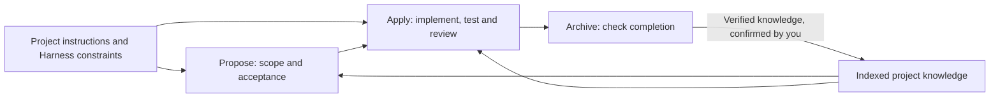
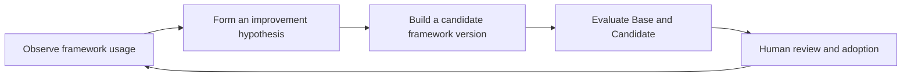
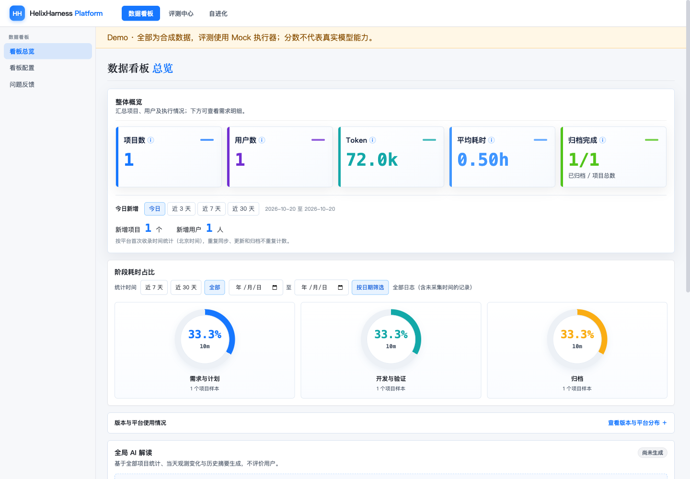
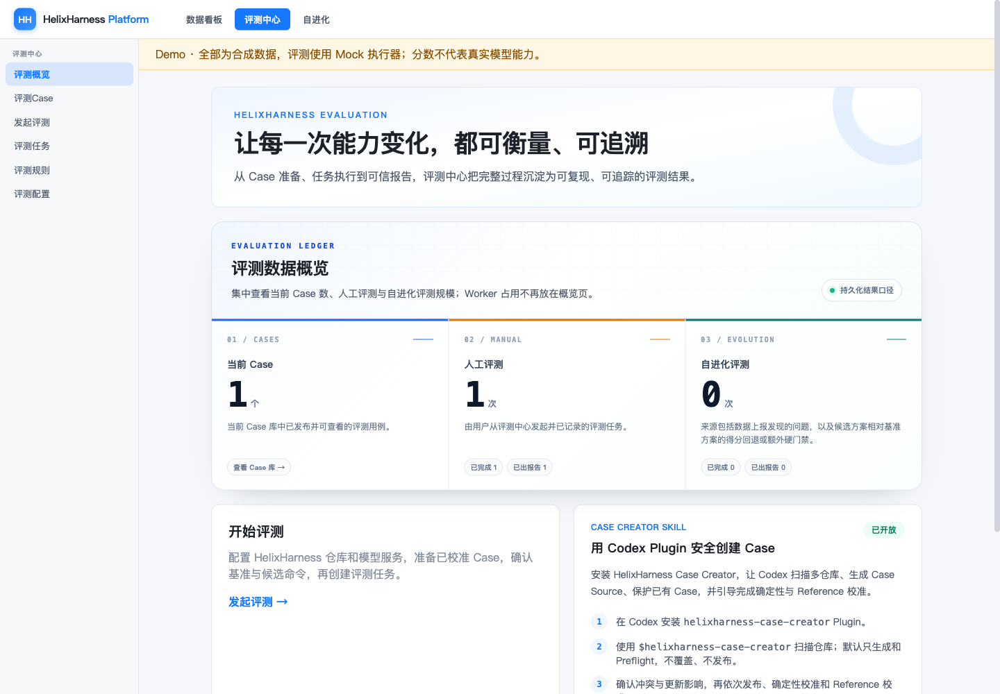
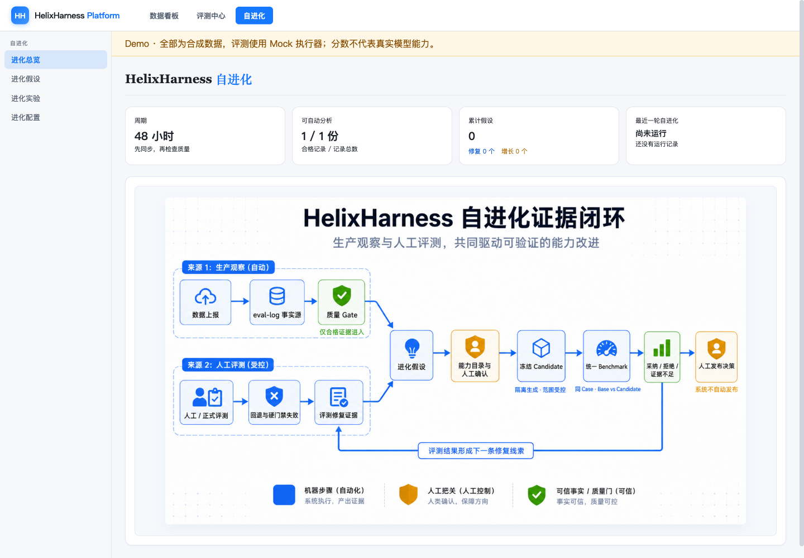

# HelixHarness

**English** | [简体中文](README.zh-CN.md)

**An AI development framework grounded in project constraints, with knowledge that compounds across tasks.**

HelixHarness brings project rules, business knowledge and a complete development workflow to Codex and Claude Code. Guide the agent from requirements through implementation, tests, review and archive—and carry verified project knowledge into the next feature.

For framework maintainers, the optional **helixharness-platform** adds observability, version evaluation and evidence-driven evolution to help improve **HelixHarness itself**.

**9 commands · Codex / Claude Code · Single repo / multi-repo Workspace · Apache-2.0**

[Quick start](#quick-start) · [Why HelixHarness](#why-helixharness) · [Framework iteration platform](#a-platform-for-iterating-on-helixharness) · [User guide](docs/user-guide.md)

## Why HelixHarness

| Capability | What it means in your project |
| --- | --- |
| **A Harness grounded in your project** | Repository instructions and indexed project constraints give the agent concrete engineering rules to follow during planning and implementation. |
| **Knowledge that compounds** | Stable, verified business rules, interface boundaries and implementation lessons can be recorded at Archive after your confirmation, then reused in later tasks. |
| **Context loaded when needed** | Harness and knowledge indexes guide which documents to load for the current requirement, task or archive step. The agent revisits context as the work changes. |
| **An inspectable development lifecycle** | Propose defines scope and acceptance; Apply implements, tests and reviews; Archive checks completion and records the outcome. Specs, tasks and evidence remain in the repository. |
| **Continuity across sessions and repositories** | Persisted workflow state supports resuming unfinished work. A multi-repo Workspace records repository responsibilities and coordinates work across services. |

Here, **Harness** means the project constraints and execution rules that guide the agent: what to read, which boundaries to respect and what evidence is required to finish. See the [context loading protocol](helixharness/reference/loading-protocol.md).



### What knowledge reuse looks like

Suppose a refund feature establishes a state transition rule and a cross-service interface boundary. After implementation and verification, Archive proposes the stable knowledge to retain, and you confirm the update. When the next refund-related feature starts, Propose and Apply can load that knowledge through the index, giving the agent an existing project reference to work from.

Knowledge accumulates as **reviewable repository documents**. You control what becomes shared project knowledge.

**Start with the plugin alone.** It works independently of the platform. The [task-filter example](examples/README.md) includes a starter project, a requirement and an independent acceptance check.

## Quick start

### 1. Install the plugin

Requirements: Python 3.10+, Git and a plugin-capable Codex or Claude Code installation. Make sure the host is signed in or has its model configuration set up and is working normally.

After the repository is public, run the commands for your host in a terminal. No manual source clone is needed:

```bash
# Codex
codex plugin marketplace add https://github.com/didi/helixharness.git
codex plugin add helix@helixharness-marketplace
```

```bash
# Claude Code
claude plugin marketplace add https://github.com/didi/helixharness.git
claude plugin install helix@helixharness-marketplace
```

The root marketplace installs the `helixharness/` plugin, not the platform. For testing before publication or modifying the plugin, use [developer installation from local source](docs/installation.md#developer-installation). See [hook verification, updates and uninstall](docs/installation.md).

### 2. Run a small feature

The product name is **HelixHarness**; its plugin ID and command namespace are **`helix`**.

Open a new agent session in the **application repository** you want to develop. Review the plugin hooks through the host's native interface, then enter these commands in the conversation:

```text
/helix:init
/helix:propose task-filter ./requirements/task-filter.md --loop
```

Use the [self-contained task-filter example](examples/README.md) to get a starter project, requirement and acceptance check. `--loop` runs Propose → Apply → Archive, pausing for decisions or blockers. It does not publish or deploy your code.

You can also run `/helix:propose`, `/helix:apply` and `/helix:archive` separately. See [all nine commands](docs/user-guide.md#commands).

Use `/helix:status` to inspect progress and blockers, and `/helix:config` to view or change telemetry consent and reporting addresses.

## How it relates to Superpowers and OpenSpec

These projects offer useful, overlapping approaches to agent-assisted development. This comparison highlights their emphasis:

| Project | Emphasis |
| --- | --- |
| [Superpowers](https://github.com/obra/superpowers) | Composable development skills and practices: brainstorming, planning, TDD, subagent execution and code review. |
| [OpenSpec](https://github.com/Fission-AI/OpenSpec) | Specification-driven change management: align on proposals, specs, design and tasks, then implement and archive changes. |
| **HelixHarness** | Bring project Harness constraints and reusable knowledge into the development lifecycle, with an optional platform to observe, evaluate and improve the framework itself. |

See [third-party notices](THIRD_PARTY_NOTICES.md) for attribution and related work.

## A platform for iterating on HelixHarness

**helixharness-platform serves maintainers who change HelixHarness's commands, workflow rules, skills and context-loading strategies.** It connects usage evidence, controlled version comparisons and candidate improvements into a framework iteration process.

| Capability | The question it helps answer | What you can inspect |
| --- | --- | --- |
| **Observability** | Where does HelixHarness encounter friction in actual use? | Workflow execution records, stage status, time and Token usage, rework and evidence quality. |
| **Evaluation** | Does this change improve the HelixHarness framework? | Frozen Base and Candidate versions exercised against the same Cases; inspect results, regression gates and execution evidence. |
| **Evolution** | Which framework change is worth testing next? | Evidence-backed hypotheses, isolated candidate changes and frozen experiments; review the proposal and decide whether to adopt the result. |

**The evaluation target is the HelixHarness framework version or change.** Development scenarios exercise that framework, and their outcomes provide evidence about its behavior. This platform supports framework iteration; it is not a general service for grading the business code HelixHarness generates.



### Three views of framework iteration

<table>
  <tr>
    <th width="33%">Observability</th>
    <th width="33%">Evaluation</th>
    <th width="33%">Evolution</th>
  </tr>
  <tr>
    <td><a href="docs/assets/platform-observability.png"></a></td>
    <td><a href="docs/assets/platform-evaluation.png"></a></td>
    <td><a href="docs/assets/platform-evolution.png"></a></td>
  </tr>
  <tr>
    <td>Locate workflow friction and resource usage.</td>
    <td>Inspect a controlled framework version comparison.</td>
    <td>Inspect the evidence loop and evolution overview.</td>
  </tr>
</table>

Click any screenshot to enlarge it. All three show the real platform UI with **synthetic demonstration data**. Evaluation uses Mock execution; the evolution view shows the evidence loop and synthetic evidence summary. These are interface examples, not measured improvements or real model results.

Real evaluation requires your own model service and calibrated Cases. Evolution proposals and candidate changes remain reviewable; adopting and publishing a framework change requires human decisions.

### Try the platform Demo

Download or clone the source first, then run these commands from the combined repository root:

```bash
# From the combined repository root
cd helixharness-platform
python3 -m venv .venv
source .venv/bin/activate
python -m pip install -e '.[server]'
python -m web_ui.demo --port 7860
```

Open [localhost:7860](http://127.0.0.1:7860). The Demo generates synthetic Case, Mock Run and telemetry data from bundled source examples in a temporary runtime directory. Generated databases, acceptance-test Runs and candidate workspaces are not included in the source or wheel. Background evolution and model analysis are disabled. The built-in Demo does not generate evolution hypotheses; the evolution screenshot shows the overview without generated hypotheses or candidates.

## Repository map

| Path | Purpose |
| --- | --- |
| [`helixharness/`](helixharness/README.md) | Agent plugin, workflow commands, host adapters and runtime tests |
| [`helixharness-platform/`](helixharness-platform/README.md) | Optional observability, evaluation and evolution for the HelixHarness framework |
| [`examples/`](examples/README.md) | Reproducible starter project and observable acceptance criteria |
| [`docs/`](docs/user-guide.md) | Configuration, workflows, troubleshooting and verification boundaries |

For version evaluation, point the platform at the source Git checkout or a directory inside it. It locates the plugin independently in each frozen commit, supporting standalone, combined and nested monorepo layouts. Multiple plugin copies require an explicit Git-relative path; no nested Git repository is required. [Evaluation setup](docs/user-guide.md#version-evaluation).

## Data and feedback

Telemetry is off until the user explicitly enables it. Async reporting and the optional feedback skill have **no default platform address**. Without a configured destination, feedback cannot be sent; the entrypoint remains available. Configuring an endpoint does not authorize sending feedback: the content and destination still require approval.

Report community bugs through [GitHub Issues](https://github.com/didi/helixharness/issues) after publication; no platform deployment is required. Follow [SECURITY.md](SECURITY.md) for vulnerabilities. [Data and feedback details](docs/user-guide.md#feedback).

## Documentation and contribution

- [Installation and updates](docs/installation.md)
- [Complete user guide](docs/user-guide.md) · [中文指南](docs/user-guide.zh-CN.md)
- [Development and contribution](CONTRIBUTING.md) · [Code of Conduct](CODE_OF_CONDUCT.md)

Source version: **HelixHarness 1.0.0 · helixharness-platform 1.0.0**. Public repository and release availability are separate from the version embedded in this source copy.

## License

[Apache License 2.0](LICENSE). See [NOTICE](NOTICE) and [third-party notices](THIRD_PARTY_NOTICES.md) for attribution and separately licensed components.
