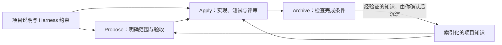
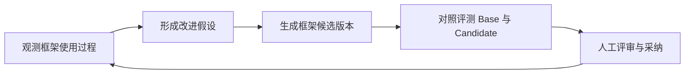

# HelixHarness

[English](README.md) | **简体中文**

**以项目约束为基础，让知识持续积累的 AI 研发框架。**

HelixHarness 将项目规范、业务知识与完整研发流程带入 Codex 和 Claude Code。从需求分析、实现、测试、评审到归档，让 AI 在明确的项目边界内开展研发，并将经验证的知识沉淀下来，供后续需求持续复用。

面向框架维护者，可选的 **helixharness-platform** 提供观测、版本评测和有证据支持的自进化能力，帮助持续改进 **HelixHarness 框架本身**。

**9 个命令 · Codex / Claude Code · 单仓 / 多仓 Workspace · Apache-2.0**

[快速开始](#快速开始) · [框架亮点](#框架亮点) · [框架迭代平台](#围绕-helixharness-框架的迭代平台) · [使用指南](docs/user-guide.zh-CN.md)

## 框架亮点

| 能力 | 对日常研发的价值 |
| --- | --- |
| **基于项目 Harness 的约束执行** | 将仓库原生说明与索引中的项目约束带入研发过程，让需求分析和实现有具体的工程规范可遵循。 |
| **知识复利** | 经验证的业务规则、接口边界和实现经验，可在归档时由你确认后沉淀，供后续需求继续复用。 |
| **按需加载上下文** | 通过 Harness 与知识索引，按当前需求、任务和归档范围读取相关文档，并随着工作推进重新判断所需上下文。 |
| **可检查的研发闭环** | Propose 明确范围与验收，Apply 完成实现、测试和评审，Archive 检查完成条件并归档；Spec、任务和证据留在仓库中。 |
| **跨会话、跨仓库协作** | 持久化工作流状态支持接着完成中断的任务；多仓 Workspace 记录各仓职责，协调跨服务研发。 |

这里的 **Harness**，指引导 Agent 工作的项目约束与执行规则：该读哪些信息、遵守哪些边界、达到什么证据要求才能完成。详见[上下文加载协议](helixharness/reference/loading-protocol.md)。



### 知识复利如何发生

例如，第一次开发退款功能时，确认了退款状态流转规则和跨服务接口边界。实现与验证完成后，Archive 提出值得保留的稳定知识，由你确认后写入项目知识文档。下一次开发退款相关需求时，Propose 和 Apply 就能通过索引读取这些知识，在已有项目事实的基础上继续工作。

知识以**可评审的仓库文档**持续积累，由你决定哪些经验成为项目的共享知识。

**先从插件开始即可。** 插件可以独立使用，无需部署平台。[任务筛选示例](examples/README.md)提供起始项目、需求和独立验收脚本，可直接上手。

## 快速开始

### 1. 安装插件

需要 Python 3.10+、Git，以及支持插件市场的 Codex 或 Claude Code。先确保宿主已完成登录或模型配置，能够正常使用。

仓库公开后，在终端选择对应宿主安装，无需先手动克隆源码：

```bash
# Codex
codex plugin marketplace add https://github.com/didi/helixharness.git
codex plugin add helix@helixharness-marketplace
```

```bash
# Claude Code
claude plugin marketplace add https://github.com/didi/helixharness.git
claude plugin install helix@helixharness-marketplace
```

根市场会安装 `helixharness/` 插件，不会安装平台。发布前测试或修改插件时，使用[开发者安装（本地源码）](docs/installation.md#developer-installation)。详见[hooks 检查、更新与卸载](docs/installation.md)。

### 2. 完成一个小需求

在要开发的**业务仓库**新开 Agent 会话，通过宿主原生界面审阅插件 hooks，然后在对话中输入：

```text
/helix:init
/helix:propose task-filter ./requirements/task-filter.md --loop
```

[任务筛选示例](examples/README.md)提供起始项目、需求和独立验收脚本，可直接跟着操作。`--loop` 串联 Propose → Apply → Archive，遇到需要决策的问题或阻断时暂停，不包含代码发布或部署。

也可分别执行 `/helix:propose`、`/helix:apply` 和 `/helix:archive`。详见[九个公开命令](docs/user-guide.zh-CN.md#命令参考)。

产品名称为 **HelixHarness**，插件 ID 和命令前缀使用 **`helix`**。使用 `/helix:status` 查看进度与阻塞，使用 `/helix:config` 查看或修改统计授权和上报地址。

## 与 Superpowers、OpenSpec 的侧重点

这些项目都在探索如何更好地组织 Agent 研发，能力有所交集。这里对比各自的主要侧重点：

| 项目 | 主要侧重点 |
| --- | --- |
| [Superpowers](https://github.com/obra/superpowers) | 可组合的研发技能与方法，涵盖头脑风暴、计划、TDD、子 Agent 执行和代码评审。 |
| [OpenSpec](https://github.com/Fission-AI/OpenSpec) | 以规范驱动变更，通过 proposal、specs、design、tasks 对齐需求，再推进实现与归档。 |
| **HelixHarness** | 将项目 Harness 约束与可复用知识融入研发闭环，并提供可选平台，持续观测、评测和改进框架本身。 |

相关借鉴与归属说明见[第三方声明](THIRD_PARTY_NOTICES.md)。

## 围绕 HelixHarness 框架的迭代平台

**helixharness-platform 面向修改 HelixHarness 命令、工作流规则、技能和上下文加载策略的框架维护者。** 它将使用证据、受控版本对比和候选改进串起来，为框架迭代提供依据。

| 能力 | 要回答的问题 | 可以查看什么 |
| --- | --- | --- |
| **可观测** | HelixHarness 在实际使用中哪里容易卡住？ | 工作流执行记录、阶段状态、耗时与 Token 用量、返工和证据质量。 |
| **可评测** | 这次修改是否让 HelixHarness 框架变得更好？ | 冻结 Base 与 Candidate，在同一组 Case 下执行，对照结果、回归门禁和执行证据。 |
| **可自进化** | 下一步值得尝试怎样的框架改进？ | 基于证据形成假设，生成隔离的候选修改，冻结后进入实验，由人评审并决定是否采纳。 |

**评测对象是 HelixHarness 框架的版本或修改。** 开发场景用于驱动框架运行，场景中的结果是判断框架行为的证据。这套平台服务于框架自身迭代，不是通用的业务代码生成质量评测服务。



### 三个视角看框架迭代

<table>
  <tr>
    <th width="33%">可观测</th>
    <th width="33%">可评测</th>
    <th width="33%">可自进化</th>
  </tr>
  <tr>
    <td><a href="docs/assets/platform-observability.png"></a></td>
    <td><a href="docs/assets/platform-evaluation.png"></a></td>
    <td><a href="docs/assets/platform-evolution.png"></a></td>
  </tr>
  <tr>
    <td>定位工作流卡点与资源消耗。</td>
    <td>查看受控的框架版本对比。</td>
    <td>查看证据闭环与进化总览。</td>
  </tr>
</table>

点击任一截图可查看大图。三张图均为真实平台界面，使用**合成演示数据**：评测采用 Mock 执行，自进化页面展示证据闭环与合成证据概览。它们用于展示功能，不代表实际改进收益或真实模型表现。

真实评测需要自己的模型服务和已校准 Case。自进化的假设与候选修改可供审阅，框架修改的采纳与发布由人决定。

### 体验平台 Demo

先下载或克隆源码，再从包含两个子项目的仓库根目录执行：

```bash
# 从包含两个子项目的根目录开始
cd helixharness-platform
python3 -m venv .venv
source .venv/bin/activate
python -m pip install -e '.[server]'
python -m web_ui.demo --port 7860
```

打开 [localhost:7860](http://127.0.0.1:7860)。Demo 从随附的合成源码示例生成 Case、Mock Run 和遥测数据，默认在临时目录中生成各模块独立的运行数据库，并关闭后台自进化和模型分析。生成的数据库、验收测试 Run 和候选工作区不随源码或 wheel 分发。内置 Demo 默认不生成进化假设；上方自进化截图展示尚未生成假设和候选的总览页面。

## 仓库结构

| 目录 | 职责 |
| --- | --- |
| [`helixharness/`](helixharness/README.md) | Agent 插件、命令、宿主适配与运行时测试 |
| [`helixharness-platform/`](helixharness-platform/README.md) | 面向 HelixHarness 框架的可选观测、评测与自进化平台 |
| [`examples/`](examples/README.md) | 可复现的起始项目及可观察的验收要求 |
| [`docs/`](docs/user-guide.zh-CN.md) | 配置、工作流、故障排查与验证边界 |

做版本评测时，将平台指向源码 Git 仓库或其内部目录。平台会从每个冻结提交中独立定位插件，支持独立、组合及多层嵌套布局；存在多个插件副本时需显式指定相对 Git 根目录的路径，无需再初始化嵌套仓库。详见[评测配置](docs/user-guide.zh-CN.md#版本评测)。

## 数据与反馈

统计需要用户明确开启。异步上报和可选反馈功能**默认没有平台地址**；未配置目的地时保留入口，但不能发送反馈。配置地址不等于同意发送，每次反馈内容和实际目的地仍需授权。

公开发布后，普通社区问题直接提交到 [GitHub Issues](https://github.com/didi/helixharness/issues)，不需要先部署平台。漏洞按[安全政策](SECURITY.md)私密报告。详见[数据与反馈说明](docs/user-guide.zh-CN.md#问题反馈)。

## 文档与贡献

- [安装与更新](docs/installation.md)
- [完整中文指南](docs/user-guide.zh-CN.md) · [English guide](docs/user-guide.md)
- [开发与贡献](CONTRIBUTING.md) · [社区行为准则](CODE_OF_CONDUCT.md)

源码版本：**HelixHarness 1.0.0 · helixharness-platform 1.0.0**。源码中的版本号不代表 GitHub 仓库或 Release 已公开发布。

## 开源协议

采用 [Apache License 2.0](LICENSE)。版权和第三方组件声明见 [NOTICE](NOTICE) 与[第三方声明](THIRD_PARTY_NOTICES.md)。
