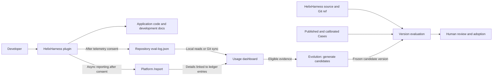

# HelixHarness User Guide

**English** | [简体中文](user-guide.zh-CN.md)

Source version: **HelixHarness 1.0.0 · helixharness-platform 1.0.0**.

**A development workflow for Codex and Claude Code, with a companion platform for usage dashboards, version evaluation and evolution.**

Take a requirement through to a verified code change: define the scope, break it into tasks, implement, test, review, and archive the result. HelixHarness gives your coding agent a reusable workflow. Requirements and progress stay in the repository so you can inspect them and resume unfinished work.

```text
Propose → Apply → Archive
  Scope    Build    Record
           └─ Tests + code review + verification evidence
```

**9 public commands · 3 core stages · Codex / Claude Code · Single repo / multi-repo Workspace · Apache-2.0**

Install **HelixHarness** for everyday development. Add **helixharness-platform** to observe usage and evaluate or improve **the HelixHarness framework itself**. Scenario results provide evidence about framework behavior; this is not a general business-code grading service.

## What's Included

| Capability | What you get |
| --- | --- |
| Development workflow | `init`, `propose`, `apply`, `archive`, `bug-fix`, `ut`, and `update` |
| Status and configuration | `status`, `config` |
| Continuous execution | `propose --loop` runs the three stages and resumes from the first unfinished stage |
| Project context | Development constraints, project knowledge, Spec, Tasks, and verification evidence |
| Multi-repo coordination | A Workspace registry, service relationships, and complete workflows in each participating repository |
| Frontend development | Design parsing, page previews, screenshots, and visual consistency checks |
| Usage monitoring | Project and stage dashboards showing collected facts such as tokens, time, and rework |
| Version evaluation | Calibrated Cases, frozen Runs, independent Workers, deterministic checks, and a model Judge |
| Evolution | Improvement hypotheses and candidates derived from eligible evidence, evaluated for human adoption |

## Navigation

- [Quick Start](#quick-start)
- [How the Two Projects Fit Together](#how-the-two-projects-fit-together)
- [Commands and Workflow](#commands)
- [Multi-repo Workspace](#multi-repo-workspace) · [Frontend Development](#frontend-development)
- [Connect Usage Data](#connect-usage-data) · [Feedback](#feedback)
- [Model Configuration](#model-configuration) · [Version Evaluation](#version-evaluation) · [Evolution](#evolution)
- [Troubleshooting](#troubleshooting)
- [Development and Contributing](#development-and-contributing) · [License](#license)

## Quick Start

### Requirements

| Use case | Requirements |
| --- | --- |
| HelixHarness plugin | Python 3.10+, Git, and a plugin-capable Codex or Claude Code installation that is signed in or has its model configuration set up and works normally |
| Platform demo or usage dashboard | Python 3.10+, Git, and the platform's `server` dependencies |
| Real version evaluation | Platform dependencies, a working Codex execution environment, model credentials, accessible Git repositories, and the build/test tools required by each Case |
| Frontend previews and visual verification | Your project's Node.js, package manager, and browser tools; configure design services as needed |

The terminal examples below use Bash / Zsh. GitHub plugin installation does not require a manual clone. Running the platform or developing the plugin requires a source checkout.

### 1. Install the Plugin

After the repository is public, run the commands for your coding agent in a terminal. For testing before publication or modifying the plugin, use [developer installation from local source](installation.md#developer-installation).

**Codex**

```bash
codex plugin marketplace add https://github.com/didi/helixharness.git
codex plugin add helix@helixharness-marketplace
```

**Claude Code**

```bash
claude plugin marketplace add https://github.com/didi/helixharness.git
claude plugin install helix@helixharness-marketplace
```

After installation, open a new agent session in the application repository you want to develop. Check that the nine public HelixHarness commands are available. See the [Codex installation guide](../helixharness/hosts/codex/installer.md) or [Claude Code installation guide](../helixharness/hosts/claude-code/installer.md) for the host-specific setup.

### 2. Build Your First Feature

Enter the following `/helix:*` commands **in your coding agent's conversation**, not in a terminal shell.

Initialize your application repository:

```text
/helix:init
```

Initialization writes project documentation and host project settings. Allow the host to write the current project's settings directory when prompted. Automated runs need an explicit permission response too: Claude Code's `acceptEdits` mode alone does not approve `.claude/settings.json`, and a sandbox protecting `.codex/` can leave Codex hooks incomplete. Check the initialization result before starting a requirement.

Create a small, concrete requirement:

```text
/helix:propose search-empty-state "Show an empty state when search returns no results, with a button to clear filters"
```

The agent reads project constraints and knowledge, clarifies the requirement, and confirms acceptance criteria before producing `spec.md` and `tasks.md`. Then implement it:

```text
/helix:apply search-empty-state
```

Once implementation, testing, and review are complete, archive the feature:

```text
/helix:archive search-empty-state
```

Staging, committing, or pushing unchanged reviewed content does not invalidate the review. If content changes after review, Archive summarizes the changes and asks you to review again (recommended) or explicitly archive without another review. The latter records your acceptance and does not mark the changed content as reviewed. Apply still requires current verification and both review approvals. Workspace handles this decision separately for each affected repository.

To run the stages continuously from the start, use:

```text
/helix:propose search-empty-state "Show an empty state when search returns no results, with a button to clear filters" --loop
```

`--loop` advances through the three stages. It still pauses for requirement decisions, acceptance boundaries, or an actual blocker. To resume an interrupted feature, use the same name in the same project:

```text
/helix:propose search-empty-state --loop
```

Completion depends on persisted artifacts, verification results, and archive state. The loop does not include publishing or deployment.

### 3. Try the Platform Demo

You can explore the platform without installing the plugin or configuring a model API. Download or clone the source, then run the following from the repository root containing both `helixharness/` and `helixharness-platform/`:

```bash
# From this project's root directory
cd helixharness-platform
python3 -m venv .venv
source .venv/bin/activate
python -m pip install -e '.[server]'
python -m web_ui.demo --port 7860
```

Open <http://127.0.0.1:7860> to explore usage dashboards, Cases, evaluation Runs, scoring rules, and evolution pages.

> The demo uses entirely synthetic data and Mock execution results, and its pages are labeled Demo. Example scores do not represent real model performance. The demo does not start real model analysis or background evolution.

The bundled synthetic source examples generate independent runtime databases in a temporary directory by default. To preserve your demo state, choose a separate directory:

```bash
python -m web_ui.demo --port 7860 --data-dir /path/to/demo-runtime
```

## How the Two Projects Fit Together

| Project | Who it is for | What it does | Where it runs |
| --- | --- | --- | --- |
| [`helixharness/`](../helixharness/README.md) | Developers using AI coding agents | Project initialization, requirements, implementation, testing, review, and archiving | Codex / Claude Code sessions and application repositories |
| [`helixharness-platform/`](../helixharness-platform/README.md) | Maintainers observing and improving the HelixHarness framework | Usage dashboards, version evaluation and evolution | A separate Python web service and evaluation Workers |



**The plugin works independently; the platform is optional.** Development does not depend on the platform being online. Disabled telemetry or failed reporting should not block normal development.

When used together, the projects connect in two ways:

1. **Observe real usage.** With telemetry enabled, the plugin writes a stage ledger in each application repository. The platform reads these ledgers and links asynchronous execution details to show stage progress, tokens, time, rework, and other collected facts.
2. **Evaluate and improve the plugin.** The platform reads HelixHarness's own source and runs frozen versions, commands, and Cases in isolated workspaces. The results help you decide whether to adopt a change.

Keep three directories distinct: **HelixHarness plugin source**, **application repositories using the plugin**, and **platform runtime data**. Usage dashboards read application repositories. Version evaluation uses the plugin source repository.

## Commands

There are nine public commands. `--loop` is an option on `propose`.

| Command | Purpose | Example |
| --- | --- | --- |
| `init` | Initialize project knowledge, constraints, and workflow directories | `/helix:init` |
| `propose` | Confirm a requirement and generate Spec / Tasks | `/helix:propose search-empty-state ./requirements/search.md` |
| `apply` | Implement an existing feature, with tests and review | `/helix:apply search-empty-state` |
| `archive` | Check completion evidence, update knowledge, and archive | `/helix:archive search-empty-state` |
| `bug-fix` | Revise an active, unarchived single-repo feature | `/helix:bug-fix search-empty-state "Clearing filters does not reload the list"` |
| `ut` | Generate and maintain unit tests | `/helix:ut` |
| `update` | Check and update the plugin from the host's configured source | `/helix:update` |
| `status` | Read feature progress, blockers, and the next suggested command | `/helix:status search-empty-state` |
| `config` | Inspect and change telemetry consent, scope, and reporting addresses | `/helix:config` |

`propose` accepts requirement text, a file path, or an accessible URL.

`ut` can ask for the scope interactively, or you can specify packages and concurrency together:

```text
/helix:ut --packages com.example.service,com.example.controller --concurrency 2
```

`bug-fix` does not reopen an archived feature; create a new feature for subsequent changes. Coordinate Workspace revisions through the root requirement.

### Inspect Progress and Change Settings

`/helix:status` lists all active features. Add a feature name for details or `--completed` to inspect the archive directory. Workspace results include repository progress and dependencies. It checks existing artifacts without running tests, advancing or repairing features. Missing completion evidence is reported; a completed task marker is not proof of review approval.

`/helix:config` is read-only by default: it shows effective telemetry consent, scope, both reporting addresses, and configuration sources. To make an explicit change:

```text
/helix:config --telemetry enabled --scope project
/helix:config --telemetry disabled --scope user
/helix:config --report-endpoint http://127.0.0.1:7860/report
/helix:config --feedback-endpoint http://127.0.0.1:7860/feedback/report
/helix:config --reset-report-endpoint
/helix:config --reset-feedback-endpoint
```

Execute one change at a time. Telemetry changes require `--scope project|user`; user-level disabling overrides project-level enabling, within the current host. Addresses are local user settings, separate from consent. Changing an address neither enables telemetry nor sends a request. Reset restores the published default, which may still name a recipient; explicitly disable consent to stop telemetry. The data notice is shown before enabling; an explicit change request does not require repeated confirmation. Corrupt configuration files are preserved and reported.

Models, credentials, application configuration, and platform deployment are outside this entrypoint. See the full [status](../helixharness/commands/status.md) and [config](../helixharness/commands/config.md) contracts.

### Workflow Artifacts

As initialization and feature execution proceed, the main artifacts in an application repository are:

```text
your-project/
├── docs/
│   ├── harness/                    # Development constraints
│   ├── knowledge/                  # Project knowledge
│   ├── specs/
│   │   ├── active/<feature>/
│   │   │   ├── spec.md             # Requirement, scope, acceptance criteria
│   │   │   ├── tasks.md            # Implementation tasks and progress
│   │   │   └── verify-report.md    # Verification evidence after implementation
│   │   └── completed/<feature>/    # Archived requirements and evidence
│   └── eval/<feature>/
│       └── eval-log.json           # Stage ledger when telemetry is enabled
└── ...                            # Application code and host entry files
```

Artifacts are created at the relevant stage. `init` does not create every feature artifact in advance, and `docs/eval/` is not required when telemetry is disabled.

### Multi-repo Workspace

Open your coding agent in the parent directory of your application repositories, for example:

```text
workspace/
├── api-service/       # Git repository
└── web-console/       # Git repository
```

Initialize the Workspace and identify the participating repositories:

```text
/helix:init --workspace --repos ./api-service ./web-console
```

This creates `helixharness.workspace.yaml` and service relationship knowledge at the root. Workspace initialization establishes the coordination layer. Each participating repository still needs its own project initialization; follow the initialization result to complete any missing setup.

Create a cross-repo feature from the Workspace root:

```text
/helix:propose search-filters "Add status filtering to the API and matching filter controls to the admin page" --loop
```

The root requirement identifies repositories and dependencies. Each repository keeps its own Spec, implementation tasks, and verification evidence. When repositories are added or relationships need refreshing, run `/helix:init --workspace --refresh`.

### Frontend Development

Provide the page goal, design files or an accessible design link, and the way to run and verify the application. Frontend workflows can use design parsing, page previews, screenshots, and visual consistency checks. Prepare the tools required by your project.

Supply your own design service authentication.

## Connect Usage Data

The usage dashboard combines two data paths: **ledger access** and **asynchronous execution details**. Connect the ledger first, then configure reporting, so each step is easy to verify.

### 1. Start the Platform with Your Application Repositories

From the platform directory, with its virtual environment active:

```bash
# Application repositories using HelixHarness, not the plugin source directory
export HELIXHARNESS_PLATFORM_HELIXHARNESS_ROOTS="/path/to/api-service,/path/to/web-console"

python -m web_ui.main --host 127.0.0.1 --port 7860 --usage-data-source auto
```

A new local installation can read these paths directly. Specify `--usage-data-source auto`: the server command otherwise defaults to `demo`. If the demo already uses the same port, stop it or choose a different port for this service.

For a platform on another machine, add each application repository's Git URL and branch in `/config`, then run synchronization. The selected branch must contain `docs/eval/*/eval-log.json`. Uncommitted or unpushed local ledgers will not appear in remote sync results. The identity running the platform's sync needs read access to those repositories.

`auto` prioritizes configured Git sync data sources. The local-path example is for a new environment without Git sync configured. Use `--usage-data-source sync` to read only synchronized data.

Startup modes differ as follows:

| Command | Without application configuration | Data and execution boundary |
| --- | --- | --- |
| `python -m web_ui.demo --port 7860` | Generates a dashboard, Case and Mock Run | Separate temporary directory; use `--data-dir` to retain demo state; model analysis and evolution scheduling are disabled |
| `python -m web_ui.main --usage-data-source auto` | Generates labeled synthetic dashboard examples | Sync cache takes priority; without Git sources, use configured local projects; fall back to examples only without local configuration |
| `python -m web_ui.main --usage-data-source sync` | Empty dashboard | Reads only Git sync cache, with no local or example fallback |
| `python -m web_ui.main --usage-data-source demo` | Generates synthetic dashboard examples | Bypasses Git cache; reads explicit local roots if provided. Selects dashboard data only, without generating Bench Cases/Runs |

The default data source for `web_ui.main` remains `demo`. In `auto`, a configured Git source awaiting synchronization, an existing empty sync cache, or an explicitly selected local directory without ledgers stays empty. Generated dashboard examples live under `.demo/` in the sync cache. Their supplements, quality projection and admission history are isolated from real data and excluded from automatic evolution evidence; fallback examples do not call models. Reload the page after connecting real sources.

A Git source's ledger directory defaults to `docs/eval` and can be another relative directory inside the repository. Sync state records the location for dashboard loading, quality validation and supplement linking. Directory and ledger file symlinks may not escape the repository; `.demo` is a reserved cache name. Synchronizing after removing or disabling all sources clears the active root list; refreshing the quality projection also removes inactive sources from automatic evolution evidence. Original ledgers, report receipts and historical runs remain intact. A partial sync failure retains caches only for sources that are still enabled and failed during this sync, without restoring deleted sources.

Saving a schedule installs the current system user's crontab and requires cron support and permission. Only five-field cron expressions or standard aliases such as `@daily` are accepted. Scheduled processes do not automatically inherit the Web service's environment; configure the same model settings and credentials in the scheduler's execution environment if it should generate AI insights. Reading or installing the crontab has a 10-second timeout. Read failures leave the schedule untouched; after an installation timeout, check `crontab -l` before retrying because the result is uncertain. Existing unrelated jobs are preserved, and incomplete platform markers prevent any write. Source tests replace crontab writes to avoid modifying developer schedules.

### 2. Configure Async Reporting and Feedback Destinations

Report and feedback use the same two configuration methods: **the publisher sets defaults in a bundled script; users can override them in local configuration files**. Developers do not need to configure every application repository. Destinations are not discovered automatically, and setting an address does not grant telemetry consent or approve feedback.

**Method 1: publisher defaults.** Before packaging a release, edit `helixharness/scripts/reporting_config.py`:

```python
DEFAULT_REPORT_ENDPOINT = ""
DEFAULT_FEEDBACK_ENDPOINT = ""
```

Both defaults are currently empty. When needed, set the complete platform `/report` and `/feedback/report` URLs, then publish or refresh the plugin. This script ships with the plugin and is copied into the async Runtime; same-version Runtime refreshes compare file contents. Ordinary users do not need to edit scripts in their installed plugin cache.

**Method 2: user-file overrides.** Users or administrators can create the following directories and files, merging `endpoint` into any existing configuration:

| Purpose | Default configuration file | Published default |
| --- | --- | --- |
| Async usage details | `~/.helixharness/telemetry/config.json` | `DEFAULT_REPORT_ENDPOINT` |
| Explicit issue feedback | `~/.helixharness/feedback/config.json` | `DEFAULT_FEEDBACK_ENDPOINT` |

`~/.helixharness/telemetry/config.json`:

```json
{
  "endpoint": "http://127.0.0.1:7860/report"
}
```

`~/.helixharness/feedback/config.json`:

```json
{
  "endpoint": "http://127.0.0.1:7860/feedback/report"
}
```

Resolution order: **nonempty user-file `endpoint` → published default → unconfigured**. Missing files, missing fields, or empty values use the published default. A malformed file, incorrect field type, or invalid nonempty URL stops that channel instead of falling back to another recipient. Remove the override file or empty `endpoint` to restore the published default. Each channel has its own destination; neither reuses the other's address.

`HELIXHARNESS_TELEMETRY_ENDPOINT` / `HELIXHARNESS_FEEDBACK_ENDPOINT` no longer configure destinations; migrate existing environment settings to the files. `HELIXHARNESS_TELEMETRY_HOME` / `HELIXHARNESS_FEEDBACK_HOME` still relocate the respective private directory and its `config.json`. Background processes must use the same HOME override.

Files work for desktop hosts and background Workers without inheriting endpoint environment variables. Destination settings stay outside application ledgers. For a remote platform, use a complete HTTP(S) address reachable from the developer's machine, without credentials, query parameters, or fragments. `127.0.0.1` refers to the sender's machine. Configuration checks validate the address format; they do not prove service availability or delivery.

### 3. Enable Telemetry and Run a Feature

Use `/helix:config --telemetry enabled --scope project` at any time, or select `disabled` to turn it off; no reminder is required.

Init and the designated Propose entrypoints ask according to the existing consent cache and reminder schedule, **even without an async destination**; step 2 is optional for ledger-only use. Continue the workflow after choosing whether to enable telemetry. Disabled choices are revisited after 30 days and enabled choices after 180 days; Apply / Archive do not add consent prompts. **Setting an endpoint does not grant telemetry consent.**

| Effective consent | Async destination | Synchronous ledger | Async collection and delivery |
| --- | --- | --- | --- |
| Not granted or disabled | Any | No new records | Neither collects nor sends |
| Enabled | Missing or invalid | Records normally; available to platform reads or Git sync | Skipped |
| Enabled | Valid | Records normally; available to platform reads or Git sync | Runs in the background; retries network failures |

When the async destination is unconfigured, normal workflows skip it silently without configuration or non-delivery notices. Explain that status only when the user asks about reporting or troubleshooting.

“Synchronous” means writing `docs/eval/<feature>/eval-log.json` during the command, followed by platform local reads or Git synchronization. **It does not introduce a synchronous HTTP reporting API.** Disabling consent stops new usage records; it does not delete historical ledgers or platform records.

Check that the application repository contains `docs/eval/<feature>/eval-log.json`, then look for the project and stage records on the platform home page. Collection, delivery, and ledger linking are asynchronous, so execution details may arrive after the stage record.

The `/report` endpoint receives supplemental execution data; it does not replace the repository ledger. Reports received before the matching ledger is discovered may remain pending linkage. Missing data is not treated as zero consumption.

The async path is: stage finish → user-level Runtime collects the consented window → sensitive-content filtering → private Outbox → `/report` → server acknowledgment → ledger linking. macOS / Windows use managed tasks, with stage-finish wakeups and ten-minute catch-up scheduling; other systems use a one-shot stage-finish wakeup or manual entrypoint. Without a valid destination, the Runtime is not installed or woken and neither collects nor sends; existing queued data stays paused. Network and transient errors retry with backoff; permanent rejections go to quarantine. Changing configuration does not redirect existing queued reports.

`completed` in eval-log means the stage finished. A collection marker or Outbox entry also does not prove delivery. Only a matching `accepted` / `duplicate` response from `/report` confirms receipt, and the platform still needs the matching ledger for complete statistics. See the [async telemetry protocol](../helixharness/reference/eval-supplement-protocol.md).

Telemetry and reporting are disabled by default. Outgoing reports pass through sensitive-content filtering. Raw source code, credentials, and unredacted conversations should not be reported. Use your deployment's access controls and network entry point when connecting a real environment.

## Use the Platform

### Pages

Paths below are relative to your platform's base URL:

| Path | Purpose |
| --- | --- |
| `/` | Project usage, stages, resource consumption, and collection status |
| `/config` | Usage data sources and other platform settings |
| `/framework-evaluation` | Version evaluation, task creation, and evaluation overview |
| `/framework-evaluation/cases` | Cases, frozen contracts, and calibration state |
| `/framework-evaluation/runs` | Runs, execution progress, checks, and scoring evidence |
| `/framework-evaluation/config` | Role models and evaluation resource budgets |
| `/framework-evaluation/rules` | Scoring rules and gates |
| `/evolution/summary` | Improvement opportunities, experiments, and candidate progress |

### Model Configuration

For everyday plugin use, configure models in Codex / Claude Code. The platform's own model configuration applies to evaluation, analysis, and other jobs it starts.

See [`helixharness-platform/.env.example`](../helixharness-platform/.env.example) for the template. The service reads **process environment variables and does not automatically load `.env.example`**. Inject real values into the environments running both the web service and Workers.

| Variable | Purpose |
| --- | --- |
| `HELIXHARNESS_PLATFORM_HELIXHARNESS_ROOTS` | Comma-separated local application repositories for the dashboard |
| `HELIXHARNESS_PLATFORM_FRAMEWORK_EVAL_HELIXHARNESS_REPOSITORY` | HelixHarness Git repository used for version evaluation |
| `HELIXHARNESS_PLATFORM_FRAMEWORK_EVAL_REFERENCE_REF` | Git ref for the reference version |
| `HELIXHARNESS_PLATFORM_FRAMEWORK_EVAL_REPOSITORIES` | Worker mappings: `repository_id=/absolute/path`, comma-separated for multiple Case repositories |
| `HELIXHARNESS_PLATFORM_EVALUATION_CODEX_BASE_URL` | Codex model service endpoint for evaluation execution |
| `HELIXHARNESS_PLATFORM_EVALUATION_CODEX_API_KEY` | Model credentials for evaluation execution |
| `HELIXHARNESS_PLATFORM_EVALUATION_CODEX_MODEL` | Evaluation execution model name |
| `HELIXHARNESS_PLATFORM_USAGE_AI_ENABLED` | Enable AI-assisted dashboard analysis; disabled by default |
| `HELIXHARNESS_PLATFORM_USAGE_AI_BASE_URL` | OpenAI-compatible API endpoint for dashboard analysis |
| `HELIXHARNESS_PLATFORM_USAGE_AI_API_KEY` | API credentials for dashboard analysis |
| `HELIXHARNESS_PLATFORM_USAGE_AI_MODEL` | Dashboard analysis model name |
| `HELIXHARNESS_PLATFORM_EVOLUTION_SCHEDULER_ENABLED` | Enable background evolution scheduling; disabled by default |

Dashboard AI analysis calls the **Chat Completions API** directly. Configure the endpoint, key, and model, then explicitly enable it. Its output is an interpretation aid, not trusted evaluation evidence for automatic evolution. Also review the role models and budgets for execution, Judge, and improvement jobs on the evaluation configuration page.

The four dashboard AI environment variables work without a Git sync YAML file. Alternatively, configure the `ai_analysis` section of `eval/configs/usage_repos.yaml`, or the file selected by `HELIXHARNESS_PLATFORM_USAGE_SYNC_CONFIG`; see [usage_repos.example.yaml](../helixharness-platform/eval/configs/usage_repos.example.yaml). Nonempty YAML `endpoint` and `model` override environment values; the environment enable switch takes priority. `api_key_env` names an environment variable, while its secret value stays in the process environment. `/config` currently offers generation controls, not a model credential editor.

Results are saved as `ai_insights.json` in `HELIXHARNESS_PLATFORM_USAGE_SYNC_CACHE` (default `eval/.cache/`), independently of local application project locations. The dashboard checks that cached results match current data and does not show an outdated interpretation as current. `HELIXHARNESS_PLATFORM_USAGE_AI_INSIGHTS` can override the read path. To verify a real model, generate analysis for your connected data and check both the background result and the actual homepage content; Mock tests or an online service are not substitutes.

### Version Evaluation

Version evaluation asks: “For the same task under frozen conditions, what changes when we use the candidate workflow instead of the baseline?” Set it up in this order.

**1. Prepare the source Git checkout.**

Configure the source Git checkout or an existing directory inside it; the platform resolves the Git root. Each frozen commit is inspected independently to locate the plugin by its `helix` manifest and `propose`, `apply`, and `archive` command files. Standalone, combined, and nested monorepo layouts are supported. The evaluator reads command documents, validates optional integrity metadata and installs only the selected plugin subtree. A source ZIP without Git history can run the plugin and Demo, but version evaluation needs a committed checkout.

```bash
# From the combined Git checkout root; use the checked-out commit as a first baseline
export HELIXHARNESS_PLATFORM_FRAMEWORK_EVAL_HELIXHARNESS_REPOSITORY="$(pwd)"
export HELIXHARNESS_PLATFORM_FRAMEWORK_EVAL_REFERENCE_REF="$(git rev-parse HEAD)"
```

Set the reference to an existing branch, tag or commit. When an origin branch matches, preview and creation refresh it; local Git repositories without origin also work. Commits remain repository-wide identities even when only the plugin subtree is evaluated. Do not initialize a nested Git repository under the plugin directory.

Discovery must find exactly one valid plugin per commit. If a commit contains multiple copies, set the server environment variable `HELIXHARNESS_PLATFORM_FRAMEWORK_EVAL_PLUGIN_PATH` to the selected Git-relative directory, such as `products/tooling/helixharness`; use `.` for the Git root. An invalid explicit path stops the preview instead of selecting another copy. Leave this setting unset to discover Base and Candidate independently when their directory layouts differ. The selected paths are frozen into the task contract, so later server configuration changes cannot redirect an existing task. No uncommitted files or symlinked entrypoints participate in discovery.

For a first baseline comparison, select the same commit for both sides. To test an actual candidate, commit the candidate changes on a separate branch in a disposable evaluation clone. Uncommitted edits are never a frozen candidate. Restart the service and Workers after changing deployment settings.

**2. Configure the execution model and role budgets.**

Inject `HELIXHARNESS_PLATFORM_EVALUATION_CODEX_BASE_URL`, `HELIXHARNESS_PLATFORM_EVALUATION_CODEX_API_KEY`, and `HELIXHARNESS_PLATFORM_EVALUATION_CODEX_MODEL`, then review the roles and budgets in `/framework-evaluation/config`. The model endpoint must support the selected executor. Real runs call the service you configure.

Formal evaluations created through the page freeze a Token budget with `token_budget_enforced=false` by default, so exceeding it does not automatically interrupt execution; it is not a hard spending cap. Execution timeouts, tool calls and disk usage have separate interruption checks. Full initialization, scanning and workflow execution can take substantial time; choose a timeout appropriate to the task. Configuration changes apply only to new tasks and do not alter a running task's frozen policy.

**3. Prepare and calibrate Cases.**

Download **HelixHarness Case Creator** from the evaluation home page and install it using the instructions in its plugin package. After extracting the ZIP, enter its `helixharness-case-creator` directory and run:

```bash
codex plugin marketplace add "$PWD"
codex plugin add helixharness-case-creator@helixharness-platform
```

Open a new Codex task after installation. Use `$helixharness-case-creator` in your target application repository to generate Case Source and run preflight checks, then confirm the publication and calibration steps. A Case needs reproducible repository revisions, a requirement, expected behavior, and checks. It should be `PUBLISHED` and `CALIBRATED` before formal use.

Start deterministic Case calibration through the CLI; the web interface currently has no start button for this step:

```bash
python -m bench.scenario_calibration_cli --help
python -m bench.scenario_calibration_cli \
  --case-id YOUR_CASE_ID \
  --repository "YOUR_REPOSITORY_ID=/path/to/business-repository"
```

Replace the IDs with the actual Case values and follow Case Creator's guidance for any required Reference calibration. Database settings and application repository mappings must refer to the same platform environment.

**4. Start an evaluation Worker.**

The web service provides pages and queue entry points; execution needs a separate Worker. In another terminal, enter the same platform directory, activate the same environment, and supply the same configuration:

```bash
python -m bench.scenario_worker \
  --adapter CODEX \
  --worker-id local-formal-worker \
  --workload-kind FORMAL_EVALUATION \
  --helixharness-repository "$HELIXHARNESS_PLATFORM_FRAMEWORK_EVAL_HELIXHARNESS_REPOSITORY" \
  --repository "YOUR_REPOSITORY_ID=/path/to/business-repository"
```

Repeat `--repository` for multiple application repositories. The web service, calibration CLI, and Worker must use the same evaluation database. Set an absolute path with `HELIXHARNESS_PLATFORM_FRAMEWORK_EVAL_DB_PATH`.

**Persistent Worker pool (recommended)**: defaults are **2 formal evaluation Workers** and **2 evolution evaluation Workers**. On the evaluation configuration page, set ‘单任务执行侧并发’ (execution-side concurrency per task, 1–4) separately for formal and evolution evaluation. The pool also uses these values as its process counts.

```bash
export HELIXHARNESS_PLATFORM_FRAMEWORK_EVAL_REPOSITORIES="YOUR_REPOSITORY_ID=/path/to/business-repository"
python -m bench.worker_pool --adapter CODEX --poll-seconds 5
```

Replace the ID with the Case repository ID and the path with its local checkout; separate multiple mappings with commas. The dashboard setting `HELIXHARNESS_PLATFORM_HELIXHARNESS_ROOTS` does not configure execution repositories. The pool also forwards repeated `--repository` arguments to its Workers.

The installed command is also available as `helixharness-worker-pool`. Web and pool processes must share `HELIXHARNESS_PLATFORM_FRAMEWORK_EVAL_CONFIG_PATH`, `HELIXHARNESS_PLATFORM_FRAMEWORK_EVAL_DB_PATH`, the HelixHarness checkout, application repository mappings, and model configuration. Saved `resources.formal_evaluation.max_concurrency` / `resources.evolution_evaluation.max_concurrency` values take precedence. Without saved settings, `HELIXHARNESS_PLATFORM_FRAMEWORK_EVAL_MAX_CONCURRENCY` can override the formal default of 2; the evolution default is 2.

**After changing counts, wait for running tasks to finish and restart the pool.** The page updates its configured limit immediately; online counts reflect Worker heartbeats. The pool restarts exited Workers. Keep the pool itself running with launchd, systemd, or another process manager. Run only one pool per database. Stopping or restarting it terminates child processes, so first check that the queue is idle. The single-Worker command remains available for debugging; `--once` does not provide a persistent service.

**Optional tutorial video**: set `HELIXHARNESS_PLATFORM_EVALUATION_TUTORIAL_VIDEO_PATH=/absolute/path/tutorial.mp4` and restart Web. The evaluation overview displays an MP4/WebM player with seeking support. When the file is unavailable or unconfigured, the text quickstart remains. Videos are operator-provided external files; the public package does not include old business footage. Configure only videos that platform visitors are permitted to watch.

**5. Create a Run and inspect its evidence.**

In the evaluation center, select ready Cases, baseline and candidate versions, and commands, then create a Run. Open its details to inspect execution status, stage artifacts, deterministic checks, Judge results, hard gates, and the final verdict. Execution finishing and evaluation passing are different outcomes; use the recorded checks and verdict to assess the result.

### Evolution

In a combined checkout, catalog `owned_paths` and `protected_paths` are relative to the Git root, for example `helixharness/commands/`. Keep `helixharness-platform/`, `.github/`, licenses and catalog/governance files protected; do not grant a candidate the whole repository.

Evolution identifies improvement opportunities from eligible evidence, generates a candidate around an explicit hypothesis, and sends it through evaluation. Before using it, prepare:

- Your own [capability catalog](../helixharness-platform/evolution/catalog/capabilities.yaml), scope, and protected paths. The distribution provides an empty catalog template.
- Published and calibrated Cases that can verify the target behavior. If Case selection returns no match for the hypothesis, candidate adoption stops before creating a Run; add and calibrate a matching Case first. A generic workflow smoke test does not establish improvement in a specific capability.
- HelixHarness Git versions that can be frozen, plus execution, analysis, and Judge configuration.
- The persistent pool includes the evolution queue. If using the single-process command, start a separate Worker with `--workload-kind EVOLUTION_EVALUATION`.

Background scheduling is disabled by default. Once the prerequisites are ready, set `HELIXHARNESS_PLATFORM_EVOLUTION_SCHEDULER_ENABLED=true` and restart the service. With no new eligible evidence, a cycle may produce no experiment. Growth opportunities require human selection. A passing candidate still needs human review and adoption; the platform does not automatically publish the plugin or deploy applications.

Candidate generation defaults to the Codex `workspace-write` sandbox for ordinary users, including local macOS users. Services running as root default to `nobody`, requiring Linux `setpriv` and appropriate directory permissions. Set `HELIXHARNESS_PLATFORM_EVOLUTION_EXECUTION_USER` to use a dedicated low-privilege deployment account. Working model access, source refs, a capability catalog and Cases are still required; installing the Codex SDK does not prove real generation works.

### Verify evaluation and evolution through the UI

Configure models, a resolvable HelixHarness Git repository, application repository mappings, and a published, calibrated Case. Start the Web service and persistent Worker pool. The built-in Demo is insufficient for this check. You may use an isolated synthetic application repository; real model calls still consume quota.

1. **Create a formal evaluation:** open Evaluation Center → Create evaluation, enter the Candidate ref or exact Commit, creator, both workflow command lists, Case type and Case. Generate a preview, inspect the frozen Commits, create the formal task, and accept the browser confirmation.
2. **Observe Workers:** inspect stage progress on the Run detail page and online/busy counts plus Run IDs on the creation page. Two formal Workers can execute both sides concurrently; one matching Worker runs them sequentially. Overall progress counts completed Case sides, so it can remain at 0% while stages advance.
3. **Inspect the report:** expand Judge reasoning and check deterministic verification, hard gates, outcome/workflow quality, and resource accounting. A completed task does not imply passing business checks. Rejecting a Candidate can be the valid result of a completed evaluation.
4. **Prepare evolution evidence:** configure the platform to read your `eval-log.json` and receive normal asynchronous `/report` supplements. Linkage and the quality gate must pass. Supplements without a ledger, or built-in Demo data alone, cannot supply automatic evolution evidence. Clearly label and isolate synthetic acceptance evidence.
5. **Generate and review a Candidate:** save the capability catalog in Evolution → Configuration and click Check new evidence. Expand the resulting hypothesis, wait for generation, inspect the file list and Diff, and adopt the Candidate through the UI to enter an experiment. `auto_repair` does not authorize automatic adoption or publication.
6. **Complete evolution evaluation:** open the linked Run from Experiments and confirm its purpose is evolution evaluation. Its separate queue defaults to two Workers, allowing Base and Candidate to run concurrently; with one Worker they run sequentially. Inspect the experiment's reconciled verdict afterward. With scheduling enabled, results are processed at the configured interval; otherwise click Check new evidence again to reconcile. Rechecking identical evidence should not create duplicate experiments.

Set `HELIXHARNESS_PLATFORM_EVOLUTION_CATALOG_PATH` to an independent runtime catalog before editing it through the UI, so local acceptance does not overwrite the shipped empty template. Paths and capability scopes follow the active server configuration. Adopting a Candidate authorizes an evaluation; publication remains a separate action.

Saved model and per-task resource settings are reloaded for the next analysis, Candidate build, or adoption submission. Existing Runs retain their frozen configuration. Worker process counts still require a pool restart. If Candidate generation fails, inspect the error, adjust reasoning effort or timeout when appropriate, and retry from the same hypothesis. After a Web restart, a hypothesis without a frozen Candidate or active generation has a Generate Candidate action instead of an indefinite preparing state.

### Data Storage

The platform uses SQLite. The distribution contains synthetic source examples in `bench/sample_data/task-filter/` and `eval/demo.py`; Demo startup generates separate module databases. Database files are not shipped. Use independent runtime directories for deployment and Demo.

[`helixharness-platform/.env.example`](../helixharness-platform/.env.example) lists optional paths for evaluation, telemetry, stage supplements, evolution databases, and platform configuration. Use a separate runtime directory to keep operational data separate from source.

Initialization creates the current schema only; it does not migrate databases from other versions. Back up runtime databases, configuration, and evaluation artifacts you need for traceability. Keep credentials, model output, and execution workspaces out of the source repository.

## Troubleshooting

<details>
<summary>Do I need the platform for everyday AI development?</summary>

No. Install HelixHarness and make sure your coding agent is signed in or has its model configuration set up and works normally. The platform adds usage dashboards, version evaluation and evolution.

</details>

<details>
<summary>Why are the commands missing after installation?</summary>

Check that the marketplace points to the combined repository root (or the plugin directory for a standalone copy) and the installed plugin is `helix@helixharness-marketplace`. Open a new host session in your application repository. If the CLI does not recognize plugin subcommands, check whether your host supports the installation method you are using.

</details>

<details>
<summary>Single-repository Init replied “completed”, but required files or hooks are missing. What should I do?</summary>

Check the reported paths, including `docs/knowledge/project-context.md`, and the current host’s project hooks. Resolve the project-write permission or failed scanner/bootstrap step, then resume Init with the same installed plugin. Do not fabricate placeholders or completion receipts. The platform validates Init outputs before saving that stage as complete; for current plugin snapshots, Propose and Apply must also satisfy the native next-stage prerequisites.

</details>

<details>
<summary>Why does the loop pause to ask questions?</summary>

`--loop` connects stages automatically, but it cannot make requirement decisions for you or skip failures. Resolve the prompt, then resume with `propose --loop` and the same feature name.

</details>

<details>
<summary>I configured /report. Why is the dashboard still empty?</summary>

Check telemetry consent, whether `docs/eval/*/eval-log.json` exists, whether the platform reads the correct directory or Git branch, whether the sender can reach the endpoint, and whether asynchronous details have been linked. Remote sync cannot see uncommitted ledgers that exist only in a developer's working directory.

</details>

<details>
<summary>Why did editing .env.example have no effect?</summary>

It is a template. Inject variables into the actual web service and Worker environments, then restart those processes. For real usage data, also pass `--usage-data-source auto` or `sync` explicitly.

</details>

<details>
<summary>Why does a Run stay queued?</summary>

Check that a Worker is running, that it uses the same database as the web service, that its `workload-kind` matches the task, and that resource settings allow the task to run.

</details>

<details>
<summary>Can I use demo scores as performance results?</summary>

No. The demo illustrates the pages and data structure. Assess actual performance using your own Cases, model configuration, and real execution results.

</details>

## Development and Contributing

The repository contains two independently installable projects:

```text
.
├── helixharness/
│   ├── commands/       # Nine public command entrypoints
│   ├── workflows/      # single/ execution and workspace/ coordination
│   ├── hosts/          # Codex / Claude Code adapters
│   ├── skills/         # Reusable workflow methods
│   └── scripts/        # Routing, artifact validation, and telemetry
└── helixharness-platform/
    ├── web_ui/         # Web pages, routes, and module composition
    ├── eval/           # Usage data and consumer quality gate
    ├── bench/          # Cases, Runs, Workers, Judge, and scoring
    └── evolution/      # Capability catalog, hypotheses, experiments, candidates
```

`skills/` contains eight reusable methods and auxiliary capabilities:

| Skill | Purpose | Used by |
| --- | --- | --- |
| [`tdd`](../helixharness/skills/tdd/SKILL.md) | Test-driven development and test design | Apply implementation |
| [`code-review`](../helixharness/skills/code-review/SKILL.md) | Standards / Spec review and re-review | Apply, after final tests |
| [`git-diff-impact`](../helixharness/skills/git-diff-impact/SKILL.md) | Call-chain, business, and compatibility impact of Git changes | Explicit standalone use; not automatically run by Apply |
| [`d-d2c`](../helixharness/skills/d-d2c/SKILL.md) | Design implementation, screenshots, and geometry comparisons | Frontend tasks with visual acceptance enabled |
| [`d2c-fidelity-evaluator`](../helixharness/skills/d2c-fidelity-evaluator/SKILL.md) | Evaluate fidelity using design and implementation artifacts | The `d-d2c` self-check workflow |
| [`brainstorming`](../helixharness/skills/brainstorming/SKILL.md) | Clarify ideas, compare options, and recommend a direction | Standalone, explicitly invoked by the user |
| [`systematic-debugging`](../helixharness/skills/systematic-debugging/SKILL.md) | Reproduce failures, test hypotheses, identify causes, and verify fixes | Standalone, explicitly invoked by the user |
| [`feedback`](../helixharness/skills/feedback/SKILL.md) | Submit HelixHarness usage issues | Standalone; requires a running platform and configured destination |

Codex installs these eight method skills alongside the nine public entry skills; Claude Code discovers the root `skills/` directly. The four lifecycle commands still use the workflow router; `status` and `config` do not advance development stages. Auxiliary skills do not add development stages; formal Spec/Tasks, progress tracking, and completion checks remain owned by those stages.

`git-diff-impact` requires no Init, active feature, or platform service. For example: “Use HelixHarness git-diff-impact to analyze uncommitted changes, --no-save.” You may instead specify two commits or branches and optional `--req` / `--design` documents. Markdown reports default to `diff-impact-reports/`; `--out` selects another location. The skill does not fix code or change review verdicts.

`code-review` and `tdd` currently operate within HelixHarness: review requires an active Spec and Apply review baseline; TDD requires testing boundaries already agreed in the Spec. Neither currently provides a standalone mode without that context.

### Start with an idea or a failure

Explicitly ask your assistant to use the HelixHarness brainstorming or systematic-debugging skill. Both are standalone tools: development commands do not invoke them, and the skills do not start development commands. Neither requires Init, an active feature, telemetry consent, or a running helixharness-platform:

- **An idea with a repository:** “Use HelixHarness brainstorming to compare ways to add batch model comparisons to this repository. Do not edit code yet.” The skill reads relevant implementation facts and returns options, tradeoffs, a recommendation, and open questions. The skill ends after delivering the discussion summary; the user decides whether to use it as input for a later requirement.
- **An idea without a repository:** “Use HelixHarness brainstorming to define the users, core use cases, and MVP for a team tool.” Deliver goals, scope, options, and assumptions to validate; the user decides whether to validate or implement the idea afterward.
- **An actual failure:** “Use HelixHarness systematic-debugging to investigate why completed tasks still appear as running.” The result covers expected versus actual behavior, reproduction, evidence, and a root cause or remaining hypotheses. A request to fix continues through a minimal fix and regression checks; a diagnosis-only request does not authorize code edits.

Both skills retain their original methods and output formats: brainstorming returns Problem, Constraints, options, Recommendation, and Open questions; systematic-debugging returns Expected, Actual, Reproduction, Root cause, and Verified fix. The skills prescribe no persisted files, create no feature, Spec/Tasks, or eval-log, and do not advance development stages. The user may choose to use the discussion summary or debugging results as input for a later requirement.

See the [workflow architecture](../docs/workflow-architecture.md) for public contracts, host boundaries, standalone operation, and validation.

Read the [HelixHarness development conventions](../helixharness/AGENTS.md) or [platform development conventions](../helixharness-platform/AGENTS.md) before making changes. For bug reports, include reproduction steps, expected behavior, actual results, and redacted logs. For code changes, explain the scope and how you verified the behavior.

Validate the plugin from `helixharness/`:

```bash
python3 scripts/run_tests.py
python3 scripts/host_runtime_cli.py list
```

Validate the platform from `helixharness-platform/` with its virtual environment active:

```bash
python -m pip install -e '.[server,dev]'
python -m pytest
python -m ruff check web_ui eval bench evolution tests
```

Tests should use synthetic data and mock external models and executors. Run real API calls, application Case calibration, and deployments only in environments explicitly configured for that purpose.


## License

Project code is licensed under [Apache-2.0](../LICENSE). Third-party components retain their own licenses; see [third-party notices](../THIRD_PARTY_NOTICES.md).

## Feedback

For community bugs use [GitHub Issues](https://github.com/didi/helixharness/issues) after publication. The optional skill below has **no default platform destination** and cannot send until one is configured.

The [auxiliary feedback skill](../helixharness/skills/feedback/SKILL.md) submits HelixHarness usage issues independently of workflow commands and telemetry consent. Users can explicitly approve feedback while telemetry is disabled; enabling telemetry does not send feedback automatically.

Start helixharness-platform and configure `/feedback/report` using the [destination settings above](#2-configure-async-reporting-and-feedback-destinations). Setting only telemetry's `/report` does not enable feedback. Without a feedback destination, preparation stops and explains how to configure it.

Ask your assistant to use the HelixHarness feedback skill. The flow is: prepare a redacted draft → show the complete content and actual destination → user approval → immediate send → server acknowledgment. Redacted current-session excerpts are optional. Drafts stay in the private local directory; preparation does not access the network. Approval binds both content and destination; changes require another review.

Only a matching feedback ID with `accepted` / `duplicate` confirms receipt; view received feedback at `/feedback`. Connection failures or transient errors show “pending” and enter the private Outbox for up to 30 days. They retry on the next send to the same destination or an explicit retry. Feedback does not use telemetry's scheduled Worker. Changing configuration does not redirect old feedback; permanent rejections keep the draft for inspection without automatic rewriting or resending.

Feedback never writes to application repositories or enables telemetry. Configure platform storage with `HELIXHARNESS_PLATFORM_FEEDBACK_DB_PATH`. See the [feedback protocol](../helixharness/reference/feedback-protocol.md).
