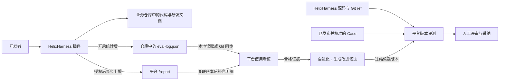

# HelixHarness 使用指南

[English](user-guide.md) | **简体中文**

当前版本：**HelixHarness 1.0.0 · helixharness-platform 1.0.0**。

**面向 Codex、Claude Code 与 OpenCode 的研发工作流，以及提供数据看板、版本评测与自进化的配套平台。**

从一个需求到有验证依据的代码变更：明确边界、拆分任务、实现、测试、评审，再把结果归档到项目中。HelixHarness 将这些步骤作为可复用的工作流交给编码助手，需求和执行进度保存在仓库里，便于检查和续跑。

```text
Propose → Apply → Archive
  需求     实现      归档
           └─ 测试 + 代码评审 + 验证依据
```

**9 个公开命令 · 3 个核心阶段 · Codex / Claude Code / OpenCode · 单仓 / 多仓 Workspace · Apache-2.0**

只做日常开发，安装 **HelixHarness** 即可。需要观测使用情况、评测和改进 **HelixHarness 框架本身**，再运行 **helixharness-platform**。开发场景的结果用于判断框架行为，平台不是通用的业务代码评分服务。

## 包含什么

| 能力 | 提供的内容 |
| --- | --- |
| 研发工作流 | `init`、`propose`、`apply`、`archive`、`bug-fix`、`ut`、`update` |
| 状态与配置 | `status`、`config` |
| 自动推进 | `propose --loop` 串联三个阶段，从第一个未完成阶段恢复 |
| 项目上下文 | 开发约束、知识库、Spec、Tasks 与验证依据 |
| 多仓协作 | Workspace 登记仓库、维护服务关系、协调各仓完整流程 |
| 前端开发 | 设计解析、页面预览、截图与视觉一致性检查 |
| 使用观测 | 项目和阶段看板，展示已采集的 Token、耗时与返工等事实 |
| 版本评测 | 已校准 Case、冻结 Run、独立 Worker、确定性检查与 Judge |
| 自进化 | 从合格证据生成改进假设与候选，通过评测后供人工采纳 |

## 导航

- [快速开始](#快速开始)
- [两个项目的关系](#两个项目的关系)
- [命令参考与工作流](#命令参考)
- [多仓 Workspace](#多仓-workspace) · [前端开发](#前端开发)
- [接入使用数据](#接入使用数据) · [问题反馈](#问题反馈)
- [模型配置](#模型配置) · [版本评测](#版本评测) · [自进化](#自进化)
- [常见问题](#常见问题)
- [开发与贡献](#开发与贡献) · [许可证](#许可证)


## 快速开始

### 环境要求

| 用途 | 要求 |
| --- | --- |
| 使用 HelixHarness | Python 3.10+、Git，以及支持插件的 Codex、Claude Code 或 OpenCode；OpenCode 需 v2.2+；宿主已完成登录或模型配置，能够正常使用 |
| 运行平台 Demo / 使用看板 | Python 3.10+、Git；安装平台 `server` 依赖 |
| 真实版本评测 | 平台依赖、可用的 Codex 执行环境、模型凭据、可访问的 Git 仓库，以及 Case 所需的构建与测试工具 |
| 前端预览与视觉验证 | 项目自身的 Node.js、包管理器及浏览器工具；设计服务按实际使用情况配置 |

下面的终端示例使用 Bash / Zsh。从 GitHub 安装插件无需先手动克隆源码；运行平台或开发插件时才需要源码副本。

### 1. 安装 HelixHarness 插件

仓库公开后，在终端选择使用的宿主，只执行对应的一组命令。发布前测试或修改插件时，使用[开发者安装（本地源码）](installation.md#developer-installation)。

**Codex**

```bash
codex plugin marketplace add https://github.com/didi/helixharness.git
codex plugin add helix@helixharness-marketplace
```

**Claude Code**

```bash
claude plugin marketplace add https://github.com/didi/helixharness.git
claude plugin install helix@helixharness-marketplace
```

**OpenCode v2.2+**

```bash
opencode plugin add 'github:didi/helixharness::path:helixharness'
```

安装后，在你要开发的业务仓库中新开宿主会话，确认能找到 `helixharness` 的九个公开命令。宿主适配说明见 [Codex 安装指南](../helixharness/hosts/codex/installer.md)、[Claude Code 安装指南](../helixharness/hosts/claude-code/installer.md) 和 [OpenCode 安装指南](../helixharness/hosts/opencode/installer.md)。

### 2. 完成第一个需求

以下 `/helix:*` 是**输入到编码助手会话中的命令**，不是终端 Shell 命令。

先在业务仓库初始化项目：

```text
/helix:init
```

Codex 和 Claude Code 会写入项目文档和宿主项目配置。宿主提示当前项目配置目录的写权限时，确认本项目后授权。自动化运行也需显式响应授权：Claude Code 的 `acceptEdits` 模式不会自动批准 `.claude/settings.json`，保护 `.codex/` 的沙箱也可能使 Codex hooks 未完成。OpenCode 没有项目 settings hook 契约，Init 只合并 `AGENTS.md`，不创建 `.opencode/` 设置。开始需求前先检查初始化结果。

再创建一个范围清晰的需求：

```text
/helix:propose search-empty-state "搜索结果为空时展示空状态，并提供清除筛选按钮"
```

助手会读取项目约束和知识，澄清需求并确认验收条件，然后生成 `spec.md` 和 `tasks.md`。确认后执行：

```text
/helix:apply search-empty-state
```

实现、测试和评审完成后归档：

```text
/helix:archive search-empty-state
```

评审后原样暂存、提交或推送，不会使评审失效。若内容发生变化，Archive 会简要说明变化，并让你选择重新评审（推荐）或明确确认后直接归档；直接归档会记录用户确认，不会把变化后的内容标记为已评审。Apply 仍要求最新验证和双轴评审通过。Workspace 按受影响的子仓分别处理这一选择。

也可以从创建需求开始连续执行：

```text
/helix:propose search-empty-state "搜索结果为空时展示空状态，并提供清除筛选按钮" --loop
```

`--loop` 会依次推进三个阶段；需要需求取舍、确认验收边界或遇到真实阻塞时仍会停下来。中断后，在同一项目中使用同名需求继续：

```text
/helix:propose search-empty-state --loop
```

完成的依据是阶段工件、验证结果和归档状态。循环不包含发布或部署。

### 3. 运行平台 Demo

如果希望先了解平台，可以运行 Demo，无需先安装插件或配置模型 API。先下载或克隆源码，再从包含 `helixharness/` 和 `helixharness-platform/` 的仓库根目录执行：

```bash
# 从本项目根目录进入平台目录
cd helixharness-platform
python3 -m venv .venv
source .venv/bin/activate
python -m pip install -e '.[server]'
python -m web_ui.demo --port 7860
```

浏览器打开 <http://127.0.0.1:7860>，可以查看使用看板、Case、评测 Run、评分规则和自进化页面。

> Demo 使用完全合成的数据和 Mock 执行结果，页面会明确标注 Demo。示例评分不代表真实模型能力；Demo 不启动真实模型分析或后台自进化。

默认从合成源码示例生成各模块的独立运行数据库，写入临时目录。需要保存演示状态时，指定独立目录：

```bash
python -m web_ui.demo --port 7860 --data-dir /path/to/demo-runtime
```

## 两个项目的关系

| 项目 | 面向谁 | 负责什么 | 运行位置 |
| --- | --- | --- | --- |
| [`helixharness/`](../helixharness/README.md) | 日常使用 AI 编码的开发者 | 初始化项目、收敛需求、实现、测试、评审、归档 | Codex / Claude Code / OpenCode 会话及业务仓库 |
| [`helixharness-platform/`](../helixharness-platform/README.md) | 观测和改进 HelixHarness 框架的维护者 | 数据看板、版本评测、自进化 | 独立 Python Web 服务与评测 Worker |



**插件可以独立使用，平台是可选的。** 插件执行研发任务不依赖平台在线；没有配置统计或上报失败，不应阻塞正常研发。

一起使用时，两者有两种联系：

1. **观察真实使用**：开启统计后，插件在业务仓库写入阶段账本，平台读取账本，并关联异步上报的执行明细，展示阶段进度、Token、耗时和返工等已采集数据。
2. **评测和改进插件**：平台读取 HelixHarness 自身的源码，在隔离工作区中按冻结的版本、命令和 Case 运行评测，用结果判断一个改动是否值得采纳。

这里有三类不同的目录：**HelixHarness 插件源码**、**使用插件的业务仓库**、**平台运行数据目录**。看板接入的是业务仓库；版本评测配置的是插件源码仓库。

## 命令参考

公开命令共九个，`--loop` 是 `propose` 的参数。

| 命令 | 用途 | 示例 |
| --- | --- | --- |
| `init` | 初始化项目知识、约束和工作流目录 | `/helix:init` |
| `propose` | 确认需求并生成 Spec / Tasks | `/helix:propose search-empty-state ./requirements/search.md` |
| `apply` | 实现已有需求，完成测试与评审 | `/helix:apply search-empty-state` |
| `archive` | 核验完成证据、更新知识并归档 | `/helix:archive search-empty-state` |
| `bug-fix` | 修订尚未归档的单仓需求 | `/helix:bug-fix search-empty-state "清除筛选后没有重新加载列表"` |
| `ut` | 生成和维护单元测试 | `/helix:ut` |
| `update` | 检查并更新宿主已配置来源的插件 | `/helix:update` |
| `status` | 只读查看需求进度、阻塞与下一步 | `/helix:status search-empty-state` |
| `config` | 查看和修改统计授权、范围及上报地址 | `/helix:config` |

`propose` 接受需求文字、文件路径或可访问 URL。

`ut` 可以交互选择范围，也可以一次指定包和并发数：

```text
/helix:ut --packages com.example.service,com.example.controller --concurrency 2
```

已归档需求不会被 `bug-fix` 重新打开；后续变更应新建需求。Workspace 的修订应通过根需求协调参与仓库。

### 查看进度与修改配置

`/helix:status` 列出全部 active 需求；传需求名查看详情，`--completed` 查询已归档目录。Workspace 同时展示参与仓库进度和依赖。只检查已有工件，不运行测试、不推进或修复需求；存在完成证据问题时如实显示，不把任务完成标记等同于评审通过。

`/helix:config` 默认只读展示统计有效开关、作用范围、两个上报地址及配置来源。明确修改时使用：

```text
/helix:config --telemetry enabled --scope project
/helix:config --telemetry disabled --scope user
/helix:config --report-endpoint http://127.0.0.1:7860/report
/helix:config --feedback-endpoint http://127.0.0.1:7860/feedback/report
/helix:config --reset-report-endpoint
/helix:config --reset-feedback-endpoint
```

每次执行一项修改。统计开关必须同时指定 `--scope project|user`；用户级关闭优先于项目级开启，用户级设置属于当前宿主。地址是本机用户配置，独立于统计授权；修改地址不会开启统计，也不会发送请求。恢复默认地址可能仍有接收方，需要停止统计时明确关闭授权。开启前展示数据说明；明确的修改请求不需要重复确认。损坏配置保留原文件并报错。

模型、密钥、业务配置和平台部署不在此入口范围内。完整合同见 [status](../helixharness/commands/status.md) 和 [config](../helixharness/commands/config.md)。

### 工作流产物

初始化和需求执行后，业务仓库中的主要目录如下：

```text
your-project/
├── docs/
│   ├── harness/                    # 开发约束
│   ├── knowledge/                  # 项目知识
│   ├── specs/
│   │   ├── active/<feature>/
│   │   │   ├── spec.md             # 需求、边界与验收条件
│   │   │   ├── tasks.md            # 实现任务和执行进度
│   │   │   └── verify-report.md    # 实现后的验证依据
│   │   └── completed/<feature>/    # 归档后的需求和证据
│   └── eval/<feature>/
│       └── eval-log.json           # 开启统计后生成的阶段账本
└── ...                            # 业务代码与宿主入口文件
```

这些文件分阶段生成。`init` 不会提前生成所有需求产物；统计关闭时也不要求生成 `docs/eval/`。

### 多仓 Workspace

在多个业务仓库的共同父目录中打开宿主会话，例如：

```text
workspace/
├── api-service/       # Git 仓库
└── web-console/       # Git 仓库
```

初始化 Workspace 并指定参与仓库：

```text
/helix:init --workspace --repos ./api-service ./web-console
```

根目录会生成 `helixharness.workspace.yaml` 和服务关系知识。Workspace 初始化负责建立协调层；参与仓库仍需完成各自的项目初始化，按初始化结果中的提示补齐。

在 Workspace 根目录创建跨仓需求：

```text
/helix:propose search-filters "API 支持状态筛选，管理页面增加对应筛选控件" --loop
```

根需求确定参与仓库和依赖，各仓保留自己的 Spec、实现任务与验证依据。新增仓库或需要更新关系基线时，使用 `/helix:init --workspace --refresh`。

### 前端开发

在需求中提供页面目标、设计文件或可访问的设计链接，并说明启动和验收方式。前端流程可使用设计解析、页面预览、截图和视觉一致性检查；相关依赖按项目实际需要准备。

设计服务的认证由使用者提供。

## 接入使用数据

平台使用看板需要两条数据通路：**账本读取**与**异步明细上报**。先接通账本，再配置上报，最容易判断问题出在哪一步。

### 1. 启动非 Demo 平台并读取业务仓库

在平台目录、已激活的虚拟环境中执行：

```bash
# 这里填写使用 HelixHarness 的业务仓库，不是插件源码目录
export HELIXHARNESS_PLATFORM_HELIXHARNESS_ROOTS="/path/to/api-service,/path/to/web-console"

python -m web_ui.main --host 127.0.0.1 --port 7860 --usage-data-source auto
```

首次本地接入可直接读取这些路径。`--usage-data-source auto` 很重要：服务命令默认的数据源模式为 `demo`。如果同一端口已有 Demo 进程，先停止它或为新服务选择其他端口。

平台部署在另一台机器上时，在 `/config` 中添加业务仓库的 Git 地址和分支，并执行同步。该分支必须包含 `docs/eval/*/eval-log.json`；本机未提交、未推送的账本不会出现在远端同步结果中。平台执行同步的身份需要有相应仓库的读取权限。

`auto` 会优先采用已配置的 Git 同步数据源；本地路径示例适用于尚未配置 Git 同步的新环境。可以使用 `--usage-data-source sync` 明确只读取同步结果。

启动方式的区别：

| 启动方式 | 无业务配置时 | 数据与执行边界 |
| --- | --- | --- |
| `python -m web_ui.demo --port 7860` | 生成看板、Case 与 Mock Run | 使用独立临时目录；可用 `--data-dir` 保留演示状态；关闭模型分析和自进化调度 |
| `python -m web_ui.main --usage-data-source auto` | 自动生成看板合成示例，并显示提示 | 优先同步缓存；无 Git 数据源时读取指定本地项目；没有本地配置才回退示例 |
| `python -m web_ui.main --usage-data-source sync` | 空看板 | 只读 Git 同步缓存，不回退到本地项目或示例 |
| `python -m web_ui.main --usage-data-source demo` | 生成看板合成示例 | 跳过 Git 缓存；指定本地根时读取该根。仅选择看板数据源，不生成 Bench 的 Case/Run |

`web_ui.main` 未指定数据源时仍默认为 `demo`。`auto` 中已有 Git 配置但尚未同步、已有空同步缓存，或明确指定的本地目录没有账本时，不会用示例掩盖空数据。自动生成的看板示例保存在同步缓存下的 `.demo/`，其明细、质量投影和首次收录记录与真实数据隔离，不进入自动进化证据；这类回退示例不调用模型。接入数据后重新加载页面即可使用真实数据。

Git 数据源的“账本目录”默认是 `docs/eval`，也支持仓库内其他相对目录。同步状态会记录该目录，看板、质量校验和异步明细关联使用同一位置。目录及账本文件的符号链接不能越出仓库；`.demo` 为缓存保留名称。删除或禁用所有数据源后再次同步，会清空当前展示根列表；刷新质量投影时，已移除来源也退出自动进化证据。原始账本、上报回执和历史运行保留。部分同步失败时，只保留仍启用且本次失败的数据源缓存，不会恢复已删除来源。

“保存计划”会安装当前系统用户的 crontab，需要系统支持并授权该用户使用 cron；仅有五字段 cron 表达式或标准 `@daily` 等别名可保存。定时任务不会自动继承 Web 进程的环境变量；需要定时生成 AI 解读时，应在定时任务的运行环境中提供同一组模型配置和凭据。读取或安装 crontab 最多等待 10 秒。读取失败不会写入；安装超时表示结果尚未确认，应先用 `crontab -l` 核对后再决定是否重试。其他定时任务原样保留，平台标记不完整时拒绝写入。当前源码测试替代 crontab 写入，避免修改开发者的定时任务。

### 2. 配置异步上报与 feedback 地址

report 与 feedback 统一支持两种配置方式：**发布方在脚本里设置默认地址，用户需要时通过本机配置文件覆盖**。普通用户无需为每个业务仓库重复配置，地址不会自动发现；设置地址也不代表统计授权或反馈发送确认。

**方式一：发布方统一配置。** 在打包发布前修改 `helixharness/scripts/reporting_config.py`：

```python
DEFAULT_REPORT_ENDPOINT = ""
DEFAULT_FEEDBACK_ENDPOINT = ""
```

当前两个默认值均为空，后续需要时分别填入实际平台的 `/report` 和 `/feedback/report` 完整地址，再发布或刷新插件。该脚本随插件分发，也会复制到异步 Runtime；同版本 Runtime 更新会比较文件内容。无需普通用户修改安装缓存中的脚本。

**方式二：用户配置文件覆盖。** 用户或管理员可以创建以下父目录和文件，已有文件合并修改 `endpoint`：

| 用途 | 默认配置文件 | 发布脚本中的默认值 |
| --- | --- | --- |
| 统计异步明细 | `~/.helixharness/telemetry/config.json` | `DEFAULT_REPORT_ENDPOINT` |
| 显式问题反馈 | `~/.helixharness/feedback/config.json` | `DEFAULT_FEEDBACK_ENDPOINT` |

`~/.helixharness/telemetry/config.json`：

```json
{
  "endpoint": "http://127.0.0.1:7860/report"
}
```

`~/.helixharness/feedback/config.json`：

```json
{
  "endpoint": "http://127.0.0.1:7860/feedback/report"
}
```

读取优先级为：**用户文件的非空 `endpoint` → 发布脚本默认值 → 未配置**。缺少文件、缺少 `endpoint` 或值为空时使用发布默认值；文件损坏、字段类型错误或非空地址无效时停止该通路，不回退到其他接收方。删除覆盖文件或清空 `endpoint` 可恢复发布默认值。两条通路独立配置，不互相复用地址。

不再通过 `HELIXHARNESS_TELEMETRY_ENDPOINT` / `HELIXHARNESS_FEEDBACK_ENDPOINT` 配置地址；已有环境变量配置需迁移到文件。`HELIXHARNESS_TELEMETRY_HOME` / `HELIXHARNESS_FEEDBACK_HOME` 仍可改变各自私有目录，届时读取该目录下的 `config.json`，后台进程也需使用同一 HOME 配置。

配置文件适用于桌面宿主和后台 Worker，不依赖终端传入地址变量。地址设置不写入业务账本。远程平台需替换为开发者机器可访问的完整 HTTP(S) 地址，不能含凭据、查询参数或 fragment；`127.0.0.1` 指向发送方本机。配置检查只验证地址格式，不证明服务在线或数据已送达。

### 3. 开启统计并执行一个需求

用户可随时通过 `/helix:config --telemetry enabled --scope project` 开启，或以 `disabled` 关闭；无需等待下次提醒。

在 Init / 规定的 Propose 入口，按既有授权缓存和提醒周期正常询问；**没有配置异步地址也照常询问**，无需先完成第 2 步。选择开启后正常执行研发命令；选择关闭后 30 天、选择开启后 180 天再提醒，Apply / Archive 不额外补问。**只设置 endpoint 不代表已经授权统计。**

| 当前授权 | 异步地址 | 同步账本 | 异步采集与投递 |
| --- | --- | --- | --- |
| 未授权或关闭 | 任意 | 不新增记录 | 不采集、不投递 |
| 已开启 | 未配置或无效 | 正常记录，平台可读取或 Git 同步 | 跳过 |
| 已开启 | 有效 | 正常记录，平台可读取或 Git 同步 | 后台处理；网络失败重试 |

未配置异步地址时，正常流程静默跳过，不额外显示地址缺失或未异步上报提示；用户主动查询上报状态时再解释。

这里的“同步”指命令执行时写入 `docs/eval/<feature>/eval-log.json`，再由平台本地读取或 Git 同步，**不是新增一条同步 HTTP 上报接口**。未授权时停止新增统计，已有账本及平台历史记录不会自动删除。

检查业务仓库是否出现 `docs/eval/<feature>/eval-log.json`，并在平台首页查看该项目和阶段记录。异步数据需要等待收集、发送与账本关联，可能晚于阶段记录出现。

平台的 `/report` 接收执行补充数据，不替代仓库中的账本。仅收到 report、尚未发现对应账本时，明细可能处于待关联状态；缺失数据不会按零消耗解释。

异步流程为：阶段结束 → 用户级 Runtime 采集授权窗口 → 脱敏 → 私有 Outbox → `/report` → 服务端确认 → 关联账本。macOS / Windows 使用受管任务，阶段结束唤醒，十分钟定时补偿；其他系统使用阶段结束的一次性唤醒或手工入口。没有有效地址时不安装/唤醒 Runtime，也不采集或投递；已有待发送队列暂停保留。网络或临时错误进入退避重试，永久拒绝进入隔离队列；修改配置不会把旧队列改投新地址。

`eval-log` 的 `completed` 仅表示阶段完成；采集标记或进入 Outbox 也不等于送达。只有 `/report` 返回对应数据的 `accepted` / `duplicate` 才表示接收成功，平台仍需关联账本才能显示完整统计。详见[异步统计协议](../helixharness/reference/eval-supplement-protocol.md)。

统计与上报默认关闭。上报前执行敏感内容过滤；原始源码、凭据和未脱敏对话不应作为上报内容。接入真实环境时，使用部署方配置的访问控制和网络入口。

## 使用平台

### 页面入口

下表路径相对于你部署的平台地址：

| 路径 | 用途 |
| --- | --- |
| `/` | 查看项目使用、阶段、资源消耗和采集状态 |
| `/config` | 配置使用数据源等平台设置 |
| `/framework-evaluation` | 进入版本评测，创建和查看评测任务 |
| `/framework-evaluation/cases` | 查看 Case、冻结合同与校准状态 |
| `/framework-evaluation/runs` | 查看 Run、执行过程、检查和评分依据 |
| `/framework-evaluation/config` | 配置角色模型和评测资源预算 |
| `/framework-evaluation/rules` | 查看评分规则与门禁 |
| `/evolution/summary` | 查看改进机会、实验和候选进展 |

### 模型配置

日常使用插件时，模型由 Codex / Claude Code / OpenCode 宿主配置。平台自身的模型配置用于平台发起的评测、分析等任务。

配置模板见 [`helixharness-platform/.env.example`](../helixharness-platform/.env.example)。服务读取**进程环境变量，不会自动加载 `.env.example`**；将真实值注入启动 Web 和 Worker 的环境。

| 配置项 | 用途 |
| --- | --- |
| `HELIXHARNESS_PLATFORM_HELIXHARNESS_ROOTS` | 看板读取的本地业务仓库，逗号分隔 |
| `HELIXHARNESS_PLATFORM_FRAMEWORK_EVAL_HELIXHARNESS_REPOSITORY` | 用于版本评测的 HelixHarness Git 仓库 |
| `HELIXHARNESS_PLATFORM_FRAMEWORK_EVAL_REFERENCE_REF` | 参考版本的 Git ref |
| `HELIXHARNESS_PLATFORM_FRAMEWORK_EVAL_REPOSITORIES` | Worker 的业务仓库映射：`repository_id=/absolute/path`，多个 Case 仓库用逗号分隔 |
| `HELIXHARNESS_PLATFORM_EVALUATION_CODEX_BASE_URL` | 评测执行使用的 Codex 模型服务地址 |
| `HELIXHARNESS_PLATFORM_EVALUATION_CODEX_API_KEY` | 评测执行使用的模型凭据 |
| `HELIXHARNESS_PLATFORM_EVALUATION_CODEX_MODEL` | 评测执行模型名称 |
| `HELIXHARNESS_PLATFORM_USAGE_AI_ENABLED` | 是否开启看板 AI 辅助分析，默认关闭 |
| `HELIXHARNESS_PLATFORM_USAGE_AI_BASE_URL` | 看板分析的 OpenAI 兼容 API 地址 |
| `HELIXHARNESS_PLATFORM_USAGE_AI_API_KEY` | 看板分析的 API 凭据 |
| `HELIXHARNESS_PLATFORM_USAGE_AI_MODEL` | 看板分析模型名称 |
| `HELIXHARNESS_PLATFORM_EVOLUTION_SCHEDULER_ENABLED` | 是否开启后台自进化调度，默认关闭 |

看板 AI 分析直接使用 **Chat Completions API**。配置地址、Key、模型并启用后才能调用；其输出是辅助解读，不作为自动自进化的可信评测证据。评测执行、Judge 和改进任务的角色模型与预算还需在评测配置页核对。

看板 AI 的四个环境变量可以独立使用，不要求先创建 Git 同步 YAML。也可在 `eval/configs/usage_repos.yaml` 的 `ai_analysis` 段配置（用 `HELIXHARNESS_PLATFORM_USAGE_SYNC_CONFIG` 可改变文件位置）；示例见 [usage_repos.example.yaml](../helixharness-platform/eval/configs/usage_repos.example.yaml)。文件中的非空 `endpoint`、`model` 优先于环境变量；启用开关以环境变量优先。`api_key_env` 只填写环境变量名称，Key 留在进程环境中。网页 `/config` 目前只提供生成按钮，不提供模型凭据编辑表单。

生成结果保存在 `HELIXHARNESS_PLATFORM_USAGE_SYNC_CACHE` 指定的缓存目录（默认 `eval/.cache/`）中的 `ai_insights.json`，本地业务项目可以位于其他目录。首页会核对结果与当前数据是否一致；数据已变化的旧解读不会作为当前结果展示。`HELIXHARNESS_PLATFORM_USAGE_AI_INSIGHTS` 可显式指定读取位置。要验证真实模型，应对自己接入的数据执行“重新生成 AI 分析”，检查后台结果及首页实际生成内容；Mock 测试或服务在线均不能替代这一检查。

### 版本评测

版本评测回答的是：“同一个任务、相同冻结条件下，候选工作流相对基准发生了什么变化？”准备顺序如下。

**1. 准备源码 Git 仓库。**

配置源码 Git 仓库或其内部已有目录，平台会解析所属 Git 根目录。平台从各自冻结提交中，根据 `helix` 插件清单和 `propose`、`apply`、`archive` 命令文件定位插件，支持独立插件仓库、组合仓库和大仓库中的任意层级子目录；读取命令正文、校验可选完整性元数据后，仅安装选中的插件快照。无 Git 历史的源码 ZIP 可以安装插件和运行 Demo，但版本评测需要已提交的 Git 仓库。

```bash
# 在整体 Git 仓库根目录执行，首次使用当前检出的提交作为基准
export HELIXHARNESS_PLATFORM_FRAMEWORK_EVAL_HELIXHARNESS_REPOSITORY="$(pwd)"
export HELIXHARNESS_PLATFORM_FRAMEWORK_EVAL_REFERENCE_REF="$(git rev-parse HEAD)"
```

基准可以是已有分支、tag 或 commit。存在同名 origin 分支时，预览和创建会刷新它；没有 origin 的本地仓库也可使用。冻结 commit 仍标识整个仓库，但评测仅安装其中的插件内容。不要在插件目录中再初始化嵌套 Git 仓库。

每个提交必须能唯一定位一个有效插件。存在多个副本时，在服务端设置环境变量 `HELIXHARNESS_PLATFORM_FRAMEWORK_EVAL_PLUGIN_PATH`，值为相对 Git 根目录的插件路径，例如 `products/tooling/helixharness`；`.` 表示 Git 根目录。显式路径无效时停止预览，不会改选其他副本。Base 与 Candidate 的目录布局不同时，保持该配置未设置，让平台分别定位。选中的路径会冻结到任务契约中，后续服务配置变化不会改变已有任务的插件选择。未提交文件和软链接入口不参与定位。

首次基线检查可让两侧选择相同提交；真正比较候选时，在独立评测 clone 的候选分支提交修改。未提交改动不能当作冻结候选。修改部署配置后重启服务与 Worker。

**2. 配置执行模型和角色预算。**

在环境中注入 `HELIXHARNESS_PLATFORM_EVALUATION_CODEX_BASE_URL`、`HELIXHARNESS_PLATFORM_EVALUATION_CODEX_API_KEY` 和 `HELIXHARNESS_PLATFORM_EVALUATION_CODEX_MODEL`，再检查 `/framework-evaluation/config` 中的角色配置与预算。模型接口需要支持所选执行器；真实运行会调用你配置的服务。

当前由页面创建的正式评测会冻结 Token 预算，但默认 `token_budget_enforced=false`，不会因超过该值自动中断；它不是强制费用上限。执行超时、工具调用和磁盘预算有独立的中断检查。完整初始化、代码扫描及工作流可能需要较长时间，应按实际任务设置超时；修改配置只影响新任务，不会改变运行中任务的冻结策略。

**3. 准备 Case 并完成校准。**

从评测首页下载 **HelixHarness Case Creator**，解压后进入包含 README 的 `helixharness-case-creator` 目录，运行：

```bash
codex plugin marketplace add "$PWD"
codex plugin add helixharness-case-creator@helixharness-platform
```

安装后新建 Codex 任务。在目标业务仓库中使用 `$helixharness-case-creator` 生成 Case Source 和执行预检查，再确认发布与校准步骤。Case 需包含可复现的仓库版本、需求、预期行为与检查依据；正式使用前应达到 `PUBLISHED` 和 `CALIBRATED`。

Case 的确定性校准通过 CLI 发起，当前 Web 没有对应启动按钮：

```bash
python -m bench.scenario_calibration_cli --help
python -m bench.scenario_calibration_cli \
  --case-id YOUR_CASE_ID \
  --repository "YOUR_REPOSITORY_ID=/path/to/business-repository"
```

将 ID 换成 Case 中的实际值，并按 Case Creator 的引导完成需要的 Reference 校准。数据库与业务仓库映射必须对应同一套平台运行环境。

**4. 启动评测 Worker。**

Web 服务提供页面和队列入口，执行任务需要独立 Worker。在另一个终端进入相同平台目录、激活同一环境，并注入相同配置：

```bash
python -m bench.scenario_worker \
  --adapter CODEX \
  --worker-id local-formal-worker \
  --workload-kind FORMAL_EVALUATION \
  --helixharness-repository "$HELIXHARNESS_PLATFORM_FRAMEWORK_EVAL_HELIXHARNESS_REPOSITORY" \
  --repository "YOUR_REPOSITORY_ID=/path/to/business-repository"
```

有多个业务仓库时，重复传入 `--repository`。Web、校准 CLI 和 Worker 必须指向同一个评测数据库；可用 `HELIXHARNESS_PLATFORM_FRAMEWORK_EVAL_DB_PATH` 指定绝对路径。

**常驻 Worker 池（推荐）**：默认正式评测 **2 个**、自进化评测 **2 个**。在「评测配置」分别调整两个队列的“单任务执行侧并发”（各 1–4）；常驻池以这些值作为启动进程数，避免页面上限与实际 Worker 数量分离。

```bash
export HELIXHARNESS_PLATFORM_FRAMEWORK_EVAL_REPOSITORIES="YOUR_REPOSITORY_ID=/path/to/business-repository"
python -m bench.worker_pool --adapter CODEX --poll-seconds 5
```

将 ID 替换为 Case 中的仓库 ID，路径指向本地业务仓库；多个映射用逗号分隔。看板的 `HELIXHARNESS_PLATFORM_HELIXHARNESS_ROOTS` 不会自动配置评测执行仓库。也可向池重复传入 `--repository`，由它转交各 Worker。

也可使用安装后的 `helixharness-worker-pool` 命令。Web 与常驻池必须共享 `HELIXHARNESS_PLATFORM_FRAMEWORK_EVAL_CONFIG_PATH`、`HELIXHARNESS_PLATFORM_FRAMEWORK_EVAL_DB_PATH`、HelixHarness 仓库、业务仓库映射及模型配置。配置文件的 `resources.formal_evaluation.max_concurrency` / `resources.evolution_evaluation.max_concurrency` 优先；未保存配置时，正式评测可由 `HELIXHARNESS_PLATFORM_FRAMEWORK_EVAL_MAX_CONCURRENCY` 覆盖默认 2，自进化默认 2。

**修改数量后，等待运行任务结束并重启 Worker 池才生效**；页面的配置上限会先更新，实际在线数以心跳为准。池管理进程负责重启异常退出的 Worker；用 launchd、systemd 或其他进程管理器守护该池进程，可在退出终端后保持运行。不要为同一数据库同时启动多个常驻池。停止或重启池会终止子进程，因此应先确认队列空闲。单 Worker 命令仍可用于调试，不要把 `--once` 当作常驻服务。

**教学视频（可选）**：设置 `HELIXHARNESS_PLATFORM_EVALUATION_TUTORIAL_VIDEO_PATH=/absolute/path/tutorial.mp4` 并重启 Web，评测首页显示播放器，支持 MP4/WebM 和拖动进度。未配置或文件不存在时保留文字快速开始入口。视频属于运营者提供的外部文件，公开包不附带旧业务画面；请仅配置允许平台访问者观看的视频。

**5. 创建 Run 并查看证据。**

在评测中心选择已就绪 Case、基准与候选版本及命令，创建 Run。进入详情查看执行状态、阶段工件、确定性检查、Judge 结果、硬门禁和最终判定。进程执行结束与评测通过是两个不同结果，应以检查和判定为准。

### 自进化

单仓发布结构中，能力目录的 `owned_paths` 和 `protected_paths` 相对于整个 Git 仓库根目录，例如 `helixharness/commands/`。保护 `helixharness-platform/`、`.github/`、许可证和能力目录等治理文件，不要向候选开放整个仓库。

自进化用于从合格证据中发现改进机会，围绕明确假设生成候选，再交给评测验证。它需要使用者先准备：

- 自己的[能力目录](../helixharness-platform/evolution/catalog/capabilities.yaml)、适用范围与受保护路径；发行版只提供空模板。
- 已发布并校准、能够验证目标行为的 Case。Case 选择未找到覆盖当前假设的匹配项时，采用候选会在创建 Run 前阻断，需先补充并校准匹配的 Case；通用工作流冒烟测试不能证明特定能力获得改善。
- 可冻结的 HelixHarness Git 版本，以及执行、分析和 Judge 所需配置。
- 常驻 Worker 池已包含自进化队列；若使用单进程命令，需另启 `--workload-kind EVOLUTION_EVALUATION` 的 Worker。

默认不启用后台调度。准备完成后可设置 `HELIXHARNESS_PLATFORM_EVOLUTION_SCHEDULER_ENABLED=true` 并重启服务。没有新增合格证据时可以不产生实验；增长型机会需要人工选择。候选评测通过后仍需人工评审与采纳，平台不会自动发布插件或部署业务。

Candidate 生成在普通用户（包括 macOS 本地用户）下默认使用 Codex 的 `workspace-write` 沙箱；root 启动服务时默认使用 `nobody`，需要 Linux `setpriv` 和目录权限支持。`HELIXHARNESS_PLATFORM_EVOLUTION_EXECUTION_USER` 可指定部署专用的低权限用户。模型、源码 ref、能力目录和 Case 均需可用，安装了 Codex SDK 不代表真实生成已验证。

### 从页面验收正式评测与自进化

先配置真实执行所需的模型、可解析的 HelixHarness Git 仓库、业务仓库映射和已发布且校准的 Case，并启动 Web 与常驻 Worker 池。内置 Demo 不能代替此验收。测试可使用独立的合成业务仓库，但模型调用仍会消耗额度。

1. **正式评测**：进入「评测中心 → 发起评测」，填写 Candidate 分支或准确 Commit、创建人、Base/Candidate 两侧工作流命令，选择 Case 类型及 Case。点击「生成确认预览」，核对冻结 Commit 后点击「确认并创建正式任务」，并确认浏览器提示。
2. **检查 Worker 执行**：在任务详情查看两侧阶段进度，在「发起评测」页查看在线数、忙闲数和任务 ID。默认 2 个正式 Worker 可分别执行两侧；只有 1 个对应 Worker 时会依次执行。总进度按完成的 Case 执行侧计数，阶段已推进时仍可能显示 0%。
3. **检查报告**：等待报告生成，展开评分与 Judge 判定依据，核对确定性检查、门禁、业务质量、工作流质量和资源统计。任务状态“已完成”不等于业务验证通过；候选被拒绝也可以是一次正常完成的评测。
4. **准备自进化来源**：让平台读取自己的 `eval-log.json`，并接收正常的 `/report` 异步补充。账本与补充的关联和质量 Gate 必须通过；仅上报补充、没有账本，或只有内置 Demo，不能形成自动进化证据。验收用合成证据应单独标注、单独存放。
5. **生成并审阅候选**：进入「自进化 → 进化配置」，保存能力目录，再点击「检查新证据」。在「进化假设」展开详情，等待候选生成，审阅实际文件清单和 Diff；随后通过页面采用候选进入实验。`auto_repair` 不代表自动采用或自动发布。
6. **完成进化评测**：在「进化实验」打开关联 Run，确认其用途为“自进化评测”，由独立自进化 Worker 队列执行；默认 2 个 Worker，可并行执行 Base/Candidate；配置为 1 个时依次执行。完成后查看实验对账结论。启用后台调度时按配置间隔处理结果；未启用时，回到「进化配置」再次点击「检查新证据」以回收结果。重复检查同一份证据应不会重复创建实验。

可以用 `HELIXHARNESS_PLATFORM_EVOLUTION_CATALOG_PATH` 将能力目录放到独立运行目录，再从页面编辑，避免本地验收覆盖发行版空模板。界面上的路径和能力范围以当前服务器配置为准。页面采用候选仅授权一次评测，正式发布仍是独立操作。

模型及单任务资源配置保存后，会在下一次分析、候选生成或采用提交时重新读取；已创建 Run 使用其冻结配置。Worker 池进程数仍需重启池生效。候选生成失败时，先查看具体错误，再按需要调整模型推理强度或超时，使用同一假设上的生成入口重试。Web 重启后若候选未冻结且没有生成任务运行，页面会提供“生成候选版本”，不会一直显示“准备中”。

### 数据存储

平台使用 SQLite。发行版只包含 `bench/sample_data/task-filter/` 和 `eval/demo.py` 中的合成源码示例，不分发数据库文件。Demo 启动时为各模块生成独立数据库；真实部署与 Demo 使用独立运行目录。

[`helixharness-platform/.env.example`](../helixharness-platform/.env.example) 列出了评测、遥测、异步补充、自进化数据库和平台配置的可选路径。将这些路径设置到独立运行目录，保留源码与运行数据的边界。

当前初始化逻辑只创建当前表结构，不负责迁移其他版本数据库。备份时保留运行数据库、配置和需要追溯的评测产物；凭据、模型输出及工作区不提交到源码仓库。

## 常见问题

<details>
<summary>只想用 AI 辅助开发，需要安装平台吗？</summary>

不需要。安装 HelixHarness，并确保宿主已完成登录或模型配置、能够正常使用即可。平台提供数据看板、版本评测和自进化。

</details>

<details>
<summary>为什么安装之后没有命令？</summary>

确认 marketplace 指向整体仓库根目录（独立插件副本可指向插件目录），安装名称是 `helix@helixharness-marketplace`，并在业务仓库中新开宿主会话。如果 CLI 不识别插件子命令，先核对宿主是否支持所用的插件安装方式。

</details>

<details>
<summary>单仓 Init 回复“已完成”，但必需文件或 hooks 缺失怎么办？</summary>

检查报出的缺失路径，包括 `docs/knowledge/project-context.md` 和当前宿主要求的项目 hooks。解决项目写入权限或失败的扫描、bootstrap 步骤后，用同一安装版本继续 Init，不要手工伪造占位文件或完成回执。平台会在保存 Init 阶段完成状态前校验产物；对当前插件快照，Propose 和 Apply 还需满足框架原生的下一阶段前置条件。

</details>

<details>
<summary>为什么 loop 停下来提问？</summary>

`--loop` 自动衔接阶段，但不能代替你确定需求取舍或跳过失败。处理提示后，用相同 feature 名的 `propose --loop` 继续。

</details>

<details>
<summary>配置了 `/report`，为什么看板仍然没有数据？</summary>

依次检查统计授权、`docs/eval/*/eval-log.json` 是否生成、平台是否读到了正确目录或 Git 分支、上报端能否访问 endpoint，以及异步明细是否已关联。远程同步看不到只存在于开发者工作区的未提交账本。

</details>

<details>
<summary>修改 `.env.example` 后为什么没有生效？</summary>

它是配置模板。需要将变量注入实际运行 Web / Worker 的环境并重启进程；使用真实数据时还应显式传入 `--usage-data-source auto` 或 `sync`。

</details>

<details>
<summary>为什么 Run 一直在排队？</summary>

检查 Worker 是否启动、Web 与 Worker 的数据库是否一致、Worker 的 `workload-kind` 是否对应任务类型，以及执行资源配置是否允许当前任务运行。

</details>

<details>
<summary>Demo 的分数可以当成性能结果吗？</summary>

不可以。Demo 用于了解页面和数据结构。实际效果需要自己的 Case、模型配置和真实执行结果。

</details>

## 开发与贡献

本仓库包含两个可以独立安装的项目：

```text
.
├── helixharness/
│   ├── commands/       # 九个公共命令入口和路由
│   ├── workflows/      # single/ 单仓执行，workspace/ 多仓协调
│   ├── hosts/          # Codex / Claude Code / OpenCode 适配
│   ├── skills/         # 工作流复用的方法
│   └── scripts/        # 路由、工件校验与遥测
└── helixharness-platform/
    ├── web_ui/         # Web 页面、路由与模块组合
    ├── eval/           # 使用数据与消费端质量 Gate
    ├── bench/          # Case、Run、Worker、Judge 与评分
    └── evolution/      # 能力目录、假设、实验和候选
```

`skills/` 包含八项复用方法与辅助能力：

| 技能 | 作用 | 使用位置 |
| --- | --- | --- |
| [`tdd`](../helixharness/skills/tdd/SKILL.md) | 测试驱动开发与测试设计 | Apply 实现阶段 |
| [`code-review`](../helixharness/skills/code-review/SKILL.md) | Standards / Spec 双轴评审与复审 | Apply 最终测试之后 |
| [`git-diff-impact`](../helixharness/skills/git-diff-impact/SKILL.md) | Git 改动的调用链、业务影响与兼容性分析 | 独立显式调用；日常 Apply 不自动执行 |
| [`d-d2c`](../helixharness/skills/d-d2c/SKILL.md) | 设计还原、截图与几何对比 | 已声明视觉还原验收的前端任务 |
| [`d2c-fidelity-evaluator`](../helixharness/skills/d2c-fidelity-evaluator/SKILL.md) | 根据设计和实现产物评估还原度 | `d-d2c` 自检流程 |
| [`brainstorming`](../helixharness/skills/brainstorming/SKILL.md) | 澄清想法、比较方案并给出推荐方向 | 由用户明确调用，独立使用 |
| [`systematic-debugging`](../helixharness/skills/systematic-debugging/SKILL.md) | 复现异常、验证假设、定位根因与验证修复 | 由用户明确调用，独立使用 |
| [`feedback`](../helixharness/skills/feedback/SKILL.md) | 提交 HelixHarness 使用问题 | 独立辅助能力；需启动平台并配置地址 |

Codex 安装目录包含九个公开入口 Skill 和上述八个方法 Skill；Claude Code 直接发现根 `skills/`；OpenCode 从同一批根文件注册为 `helix-<name>`。四个生命周期命令继续使用工作流路由；`status`、`config` 与辅助 Skill 不增加研发阶段。正式 Spec/Tasks、执行进度和完成验证仍由对应研发阶段负责。

`git-diff-impact` 无需 Init、活跃 feature 或平台服务。示例：“使用 HelixHarness git-diff-impact，分析当前未提交改动，--no-save”；也可明确提供两个提交或分支，以及 `--req` / `--design` 文档。默认保存 Markdown 到 `diff-impact-reports/`，`--out` 可指定位置。它不自动修复代码，也不改变评审结论。

`code-review` 和 `tdd` 当前是 HelixHarness 流程内方法：前者依赖活跃 Spec 和 Apply 评审基线，后者依赖 Spec 中已确认的测试边界。它们尚不支持脱离这些上下文的独立模式。

### 从想法或异常开始

在编码助手中明确要求使用 HelixHarness brainstorming 或 systematic-debugging Skill。两者作为独立工具使用，不由研发命令自动触发，也不启动研发命令；无需先执行 Init、创建需求、开启统计或启动 helixharness-platform：

- **有代码库、有想法**：“使用 HelixHarness brainstorming，基于当前代码库比较批量模型对比的实现方案，先不改代码。”读取相关实现后，产出方案取舍、推荐方向和未决问题；交付讨论摘要后结束，由用户决定是否将其作为后续需求输入。
- **没有代码库、只有想法**：“使用 HelixHarness brainstorming，我想做一个团队工具，先明确用户、核心场景和最小可用版本。”产出目标、范围、方案和待验证假设，由用户决定后续是否验证或实现。
- **已有实际异常**：“使用 HelixHarness systematic-debugging，排查任务完成后页面仍显示运行中的原因。”产出预期与实际、复现、证据、根因或剩余假设；用户要求修复时继续最小修复和回归验证。只要求排查时不自动改代码。

两项 Skill 使用各自的方法和输出格式：brainstorming 输出 Problem、Constraints、候选方案、Recommendation 和 Open questions；systematic-debugging 输出 Expected、Actual、Reproduction、Root cause 和 Verified fix。两项 Skill 不规定持久化文件，不创建 feature、Spec/Tasks 或 eval-log，也不推进研发阶段。用户可自行将讨论摘要或调试结果作为后续需求输入。

公共合同、宿主边界、独立运行和验证方式见[工作流架构](../docs/workflow-architecture.md)。

修改前阅读 [HelixHarness 开发约定](../helixharness/AGENTS.md) 或[平台开发约定](../helixharness-platform/AGENTS.md)。提交问题时提供复现步骤、预期行为、实际结果和脱敏后的日志；代码改动应说明影响范围及验证方式。

插件验证，在 `helixharness/` 下执行：

```bash
python3 scripts/run_tests.py
python3 scripts/host_runtime_cli.py list
bun test opencode/tests
bun run typecheck
```

平台验证，在 `helixharness-platform/` 的虚拟环境中执行：

```bash
python -m pip install -e '.[server,dev]'
python -m pytest
python -m ruff check web_ui eval bench evolution tests
```

测试应使用合成数据并 Mock 外部模型与执行器。真实 API 调用、业务 Case 校准和部署在使用者明确配置的环境中执行。


## 许可证

项目代码采用 [Apache-2.0](../LICENSE)，第三方组件保留各自许可，见[第三方声明](../THIRD_PARTY_NOTICES.md)。

## 问题反馈

公开发布后普通社区问题直接走 [GitHub Issues](https://github.com/didi/helixharness/issues)。以下可选反馈功能默认没有平台地址；未配置目的地时保留入口，但不能发送。

[feedback 辅助 Skill](../helixharness/skills/feedback/SKILL.md) 用于提交 HelixHarness 自身的使用问题，独立于研发命令及统计授权：统计关闭时仍可由用户明确确认发送 feedback；开启统计不会自动发送反馈。

先启动 helixharness-platform，并按[地址配置说明](#2-配置异步上报与-feedback-地址)设置 `/feedback/report` 接收地址。仅配置统计的 `/report` 不会启用反馈；feedback 未配置地址时停止准备，并提示配置方法。

在编码助手中要求使用 HelixHarness feedback Skill。流程为：准备脱敏草稿 → 展示完整内容和实际地址 → 用户确认 → 立即发送 → 服务端确认。可选附带脱敏后的当前会话摘录；草稿只保存在本机私有目录，准备阶段不联网。确认绑定内容和地址，修改后需重新审核。

只有服务端返回匹配 feedback ID 的 `accepted` / `duplicate` 才算送达，可在平台 `/feedback` 页面查看。连接失败或临时错误显示“待发送”，进入私有 Outbox，最长保留 30 天；下次向同地址发送或显式重试时补投。feedback 不使用统计的定时 Worker；修改配置不会把旧反馈改投到新地址。永久拒绝保留草稿供检查，不自动重写或重发。

反馈不会写入业务仓库或自动开启统计。平台存储路径由 `HELIXHARNESS_PLATFORM_FEEDBACK_DB_PATH` 配置。详见[反馈协议](../helixharness/reference/feedback-protocol.md)。
