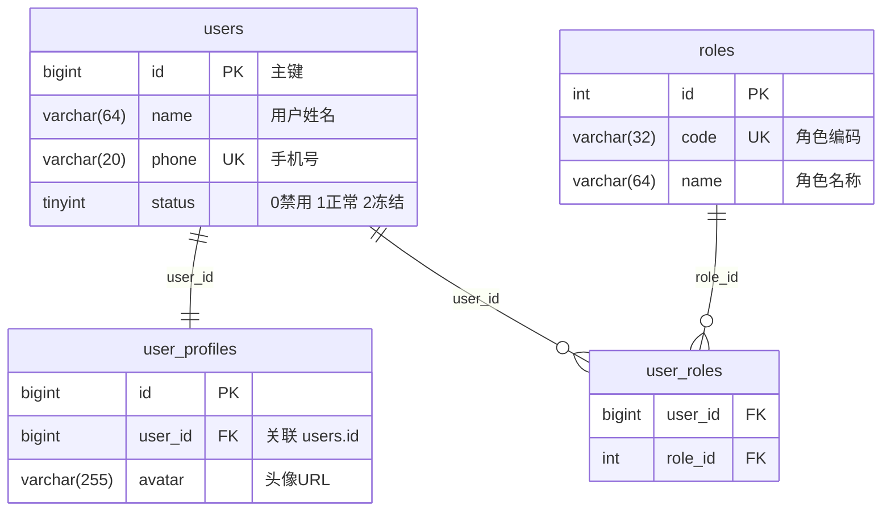
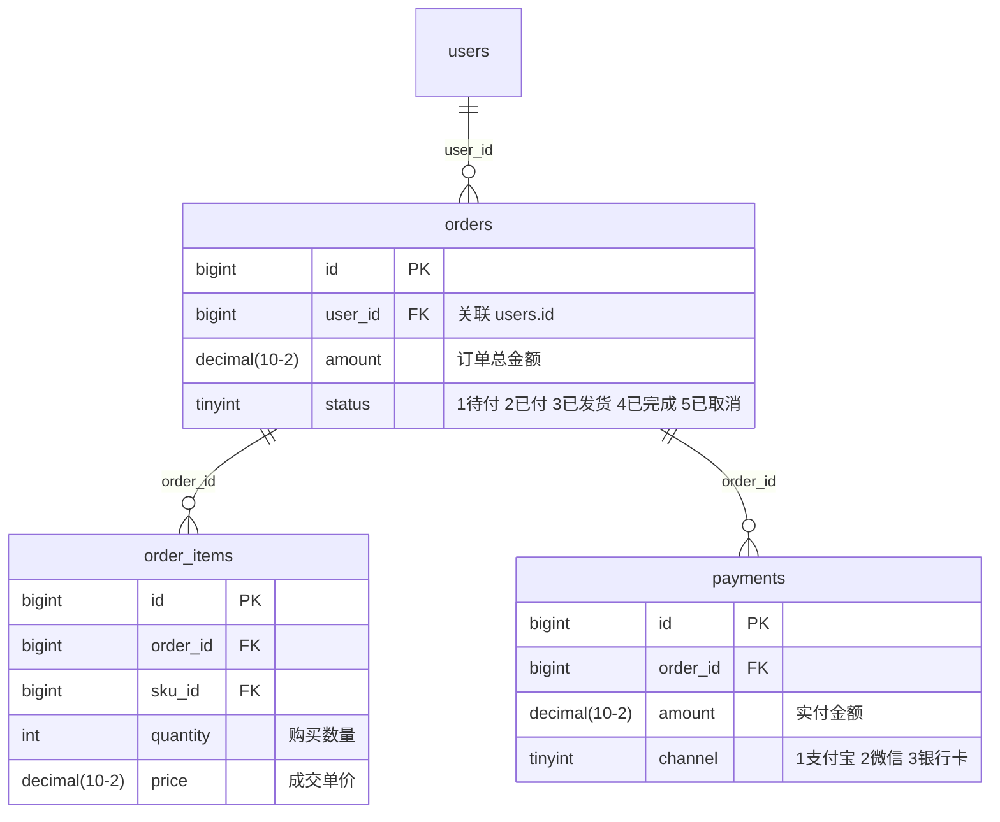

## 任务：生成项目数据模型清单

你是一名数据库架构师。请扫描整个代码库，生成一份完整的数据库表结构清单。

## 输出要求

- **位置**：`docs/knowledge/database/index.md`（表清单总览 + 字段详情，作为内容文件由根 `knowledge/index.md` 索引），ER 图独立输出到 `docs/knowledge/database/er.md`
- **格式**：Markdown
- **er.md** 是独立的可视化文档，格式要求见下方"ER 图输出格式"章节

## 扫描策略

### 0. 表认定门槛（必须先判定，再进入表定义定位）

一张表只有在本仓库存在**持久化证据**时，才认定为"本服务数据表"，纳入表清单与 ER 图。持久化证据 = 以下任一：
- ORM 映射：`@Entity`/`@Table`/`@TableName`、MyBatis `@Mapper`/`<resultMap>`/Mapper XML、GORM Model、JPA Repository
- 数据访问接入：JDBC/数据源配置（`spring.datasource`/JDBC URL/HikariCP/Druid）、`@DS`、有效 JDBC/MyBatis/JPA 依赖

以下**不构成**认定依据，不得据此新增表到清单或 ER 图：
- 测试类（`src/test/`）里硬编码的表名或 SQL
- 代码注释、TODO、文档中提到的表名
- 字符串常量、日志文本中出现的表名
- 下游 RPC 返回结构反推的表名

> 判定流程：先确认本仓库是否存在上述持久化证据，再决定是否进入后续扫描：
> - **四类证据全部为空 → 判定"本服务无直连数据库"**：跳过下方「表定义定位 / 枚举识别 / 索引识别 / 分库分表识别 / 多数据源标注」全部扫描步骤，直接按"输出格式"中的「无表情形」模板生成 `database/index.md` 与 `er.md`。严禁仅凭表名引用产出表清单。
> - **任一类证据非空 → 进入下方扫描流程**，按有表模板产出正常表清单。


### 1. 表定义定位

按以下优先级扫描，尽量多源交叉验证：

**Java 项目**
扫描策略（含多模式兼容）：
- 优先识别 JPA/Hibernate 模式：扫描 @Entity / @Table 和 @Column 注解。如果此类注解覆盖度较高，以此为主。
- MyBatis 模式兜底：若 JPA 注解极少，则重点扫描 src/main/resources/mapper/ 下的 XML 文件。提取 <resultMap> 的列映射，并使用 JSqlParser 解析 SQL 语句中的表名。
- 纯 SQL 正则/解析兜底：针对无法定位到实体类的项目，遍历所有 DAO/Service 层代码，提取 SQL 字符串，匹配 FROM、JOIN、INSERT INTO 关键字。

**Go 项目**
- GORM Model 定义（`gorm:"column:xxx"`）
- SQL migration 文件（`.sql`）

**通用**
- `sql/`、`migrations/`、`schema/`、`db/` 目录下的 `.sql` 文件
- `CREATE TABLE` 语句 → 最权威的 schema 来源，优先使用

### 2. 枚举识别

- 找到字段关联的枚举类，列出所有枚举值和含义
- 若无枚举类，从注释或业务代码中推断状态含义
- **枚举值必须写入 database.md 对应字段的"枚举值说明"列**，格式：`值:含义`，多个值用顿号分隔，如 `0:禁用、1:正常、2:冻结`

### 3. 索引识别

- `@Index` / `@UniqueConstraint` 注解
- SQL 文件中的 `CREATE INDEX` / `UNIQUE KEY` 语句
- GORM tag 中的 `uniqueIndex` / `index`

### 4. 分库分表识别

- ShardingSphere 配置文件
- 自定义分表注解或路由逻辑
- 若无分表，填"无"

### 5. 多数据源标注

- 识别 `@DS` 注解（dynamic-datasource）或多 DataSource Bean 配置
- 标注每张表属于哪个数据源

## 输出格式

### database.md 格式

```markdown
# 数据模型清单

> 生成时间：YYYY-MM-DD
> 数据表总数：N 张

## 1. 表清单总览

| 序号 | 表名 | 中文名称 | 核心字段 | 分库分表 | 数据源 | 所属模块 |
| :--- | :--- | :--- | :--- | :--- | :--- | :--- |
| 1 | users | 用户表 | id, name, phone, status | 无 | master | 用户 |
| 2 | orders | 订单表 | id, user_id, amount, status | user_id % 16 | order_db | 订单 |

## 2. 表字段详情

### 2.1 users（用户表）

| 字段名 | 数据类型 | 允许为空 | 默认值 | 字段含义 | 枚举值说明 |
| :--- | :--- | :---: | :--- | :--- | :--- |
| id | bigint | 否 | - | 主键ID | - |
| name | varchar(64) | 否 | - | 用户姓名 | - |
| status | tinyint | 否 | 1 | 用户状态 | 0:禁用、1:正常、2:冻结 |
| created_at | datetime | 否 | CURRENT_TIMESTAMP | 创建时间 | - |

> 枚举值说明：有枚举类或注释时必须填写完整，格式为 `值:含义`，多个值用顿号分隔；无法确定时标注 `<!-- TODO: 待确认 -->`

**索引**

| 索引名 | 类型 | 字段 | 说明 |
| :--- | :--- | :--- | :--- |
| PRIMARY | 主键 | id | - |
| uk_phone | 唯一索引 | phone | 手机号唯一 |
| idx_status | 普通索引 | status | 按状态查询 |

---

*共计 N 张数据表*
```

#### 无表情形（database/index.md）

当"表认定门槛"判定本服务无直连数据库时，**跳过上方有表模板**，按以下模板输出 `database/index.md`：

```markdown
# 数据模型清单

> 生成时间：YYYY-MM-DD
> 数据表总数：0 张

## 扫描结论

本服务无直连数据库（未识别到任何持久化证据）。

已验证为空的证据清单：
- 无 `@Entity` / `@Table` / `@TableName` 等 ORM 映射注解
- 无 MyBatis `@Mapper` / `<resultMap>` / Mapper XML
- 无 `CREATE TABLE` / DDL 文件（`sql/`、`migrations/`、`schema/`、`db/` 目录下均无）
- 无数据源配置（`spring.datasource` / JDBC URL / HikariCP / Druid / `@DS`）
- 无有效 JDBC / MyBatis / JPA 依赖

> 结论：本服务不直接持有数据表。代码中出现的表名仅为文本引用，权威 schema 需查阅下游数据服务。

## 表清单总览

（无）

## 表字段详情

（无）

## 附录：跨服务数据线索（非本服务表）

> 仅当代码（测试类/注释/字符串）中确实出现表名引用时填写本节；否则整节省略。

| 引用表名 | 来源文件:行号 | 引用上下文 | 推测归属服务 |
| :--- | :--- | :--- | :--- |
| xxx | src/test/.../FooTest.java:42 | 测试 SQL 中出现 | 待确认 |
```

### er.md 格式

er.md 是独立的 ER 关系图文档，按业务模块分区，每个模块用独立 mermaid 代码块展示，并附带文字说明提升可读性。

```markdown
# ER 关系图

> 生成时间：YYYY-MM-DD
> 说明：按业务模块分区展示，聚焦核心关联字段，省略纯审计字段（created_at / updated_at 等）

---

## 模块一：用户体系

**包含表**：users、user_profiles、user_roles

**关系说明**：
- `users` 1:1 `user_profiles`：每个用户对应一份扩展信息
- `users` N:N `roles`（通过 `user_roles` 中间表）：用户可拥有多个角色



---

## 模块二：订单体系

**包含表**：orders、order_items、payments

**关系说明**：
- `orders` 1:N `order_items`：一笔订单包含多个商品行
- `orders` 1:N `payments`：一笔订单可有多次支付记录（如拆单支付）



---

## 跨模块关联

**说明**：列出跨越以上模块边界的关联关系，帮助理解整体数据流向。

```
| 主表 | 关联表 | 关联字段 | 关系 | 跨模块含义 |
| :--- | :--- | :--- | :--- | :--- |
| orders | users | orders.user_id → users.id | N:1 | 订单归属用户（订单体系 → 用户体系） |
```

**er.md 生成规则**：
1. 按业务模块聚合，每模块一个 mermaid 块，不要把所有表塞进一个图
2. 每个实体只写**核心字段**（主键、外键、关键业务字段），省略 created_at / updated_at / deleted_at 等审计字段
3. 字段注释用引号写在类型后面，把枚举值的关键含义直接标在字段上（如 `"0禁用 1正常"`）
4. 每个模块前写"关系说明"文字，用自然语言描述关联含义，不要只靠图形表达
5. 跨模块的外键关系统一收录到最后的"跨模块关联"表格中

#### 无表情形（er.md）

当本服务无直连数据库时，er.md 只写一段说明，**不画任何 mermaid 图**：

```markdown
# ER 关系图

> 生成时间：YYYY-MM-DD
> 说明：本服务无直连数据库，未识别到任何数据表，无可绘制 ER 关系。
```

## 注意事项

- 若同一张表在多处定义（Entity + SQL 文件），以 SQL 文件为准，Entity 作为补充
- 无法确定枚举含义时标注 `<!-- TODO: 待确认 -->`
- 无法确定中文名称时标注 `<!-- TODO: 待确认 -->`
- 不修改共享 `docs/knowledge/index.md`。在 final 返回本 job 的已写入产物及索引建议，由 bootstrap 在扫描全部完成后串行合并索引。

### 无数据库情形

若经"表认定门槛"判定本仓库**无任何持久化证据**（四类全空）：
1. **直接套用上方输出格式中的「无表情形」模板**：`database/index.md` 走"无表情形（database/index.md）"模板，`er.md` 走"无表情形（er.md）"模板；表清单总数为 0，不画 mermaid 图，严禁沿用有表模板。
2. `database/index.md` 顶部"扫描结论"明确写"本服务无直连数据库"，并列出已验证为空的证据清单（无 @Entity/@Table、无 Mapper、无 DDL、无 datasource 等）。
3. 代码中出现的表名（测试类/注释/字符串）**一律不进入表清单与 ER 图**；确有参考价值时，收敛到 `database/index.md` 末尾"## 附录:跨服务数据线索（非本服务表）"小节，逐条标注 `来源文件:行号`，并注明"仅文本引用，非本服务表，权威 schema 需查阅下游 XX 中心服务"。
4. 不得为凑数把推断表塞进表清单或 ER 图。

## 交付与写域

完整遵循 `reference/scan-agent-protocol.md`，只写当前 job 授权的产物；共享 knowledge 根索引由 bootstrap 串行维护。
