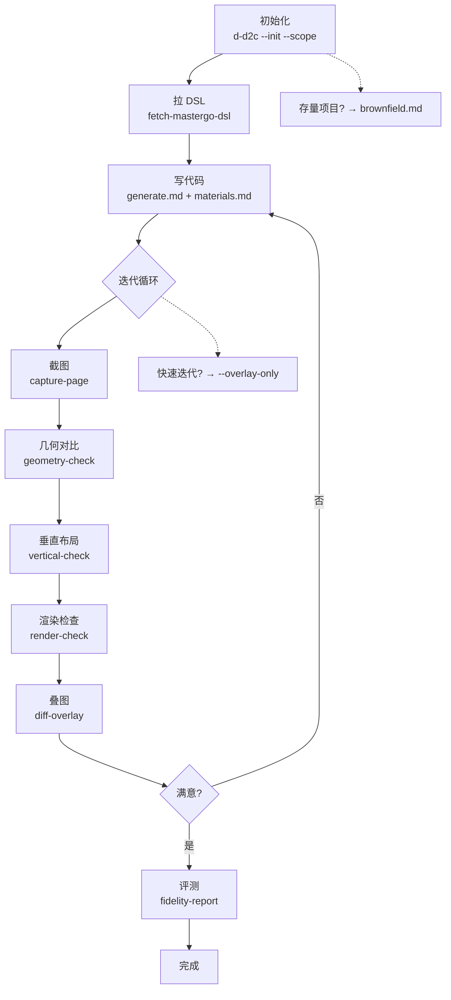

## 工作流概览



> **规则文件索引：** [generate](rules/d-d2c-generate.md) · [materials](rules/d-d2c-materials.md) · [design-crop](rules/d-d2c-design-crop.md) · [preview](rules/d-d2c-preview.md) · [component](rules/d-d2c-component.md) · [update-page](rules/d-d2c-update-page.md) · [brownfield](rules/d-d2c-brownfield.md)

# d-d2c 工作流

d-d2c 用于按 **MasterGo 设计页链接拉取 DSL**，再基于 **`Layer.md`（布局树）+ `dom.md`（DOM/CSS）+ `styles.md`（样式规格表）** + 设计稿实现页面还原。


## 鉴权页面 / 需要登录态

### 注入 Session（cookie + localStorage）

`--session-state` 接受 JSON 字符串，在 Puppeteer 导航前注入：

```bash
# 注入 cookie
node d2c-capture-page.cjs --url http://localhost:8080/demo-page \
  --session-state '{"cookies":[{"name":"token","value":"abc123","domain":"localhost"}]}'

# 注入 localStorage
node d2c-capture-page.cjs --url http://localhost:8080/demo-page \
  --session-state '{"localStorage":{"role":"agent","stage":"4"}}'
```

也可通过环境变量 `D2C_SESSION_STATE` 传入。

JSON 结构：
- `cookies`: `[{name, value, domain?, path?}]` — 通过 `page.setCookie()` 注入
- `localStorage`: `{key: value}` — 通过 `evaluateOnNewDocument` 注入
- `origin`: 可选，指定 localStorage 绑定的 origin

### 注入 Mock 数据

使用 `--mock` 注入 JSON 到 `window.__MOCK__`，或 `--mock-script` 执行自定义 JS：

```bash
# 注入 JSON
node d2c-capture-page.cjs --url http://localhost:8080/demo-page \
  --mock '{"userInfo":{"id":1,"name":"test"}}'

# 执行 mock 脚本
node d2c-capture-page.cjs --url http://localhost:8080/demo-page \
  --mock-script ./mock.js
```

Mock 通过 `page.evaluateOnNewDocument` 在 `page.goto` **之前**注入，抢在所有页面脚本执行前生效。对"挂载即 fetch"的 Vue App，API 拦截、全局 Promise 覆写等 mock 策略在首屏请求发出前已就位。

#### 🔍 Agent 主动检测 & 自动 Mock（⛔ 截图后必须执行）

**每轮截图完成后，Agent 必须检查目标组件是否渲染了真实业务数据。不满足时自动生成并注入 mock 数据，无需用户介入。**

**检测标准（截图后立即判断）：**

| 信号 | 判断 | 动作 |
|------|------|------|
| 目标组件 DOM 存在但内容为空（骨架屏/加载中/占位符） | 数据未到位 | 进入 mock 生成流程 |
| 目标组件 `v-if`/`v-show` 条件不满足，整个组件不渲染 | 依赖数据缺失 | 进入 mock 生成流程 |
| 列表为空、文案显示默认值/空字符串 | API 未返回数据 | 进入 mock 生成流程 |
| 页面重定向到登录/错误页 | 鉴权问题，非数据问题 | 走 session-state / CDP 路径 |

**Mock 生成流程（Agent 自动执行，不询问用户）：**

1. **读取组件源码**：分析目标 `.vue` 的 `<script>` 部分，识别：
   - `props` 定义（需要父组件传入的数据结构）
   - `computed` 中从 props/store 派生的字段
   - `v-if`/`v-for` 的驱动条件
   - API 调用（axios/fetch/request 等）及返回数据结构

2. **向上追溯数据源**：props 是父组件传的 → 读父组件 → 追溯到最终数据源：
   - API 响应（看接口返回的字段）
   - Store state（Vuex/Pinia/Redux）
   - 路由参数

3. **生成 mock 脚本**（写入 `d-d2c/temp/<page>/mock.js`，不残留到业务 diff）：
   ```js
   // 策略 A（优先）：在页面挂载前拦截数据源
   // 覆盖 window.fetch / XMLHttpRequest，对匹配 URL 返回 mock 数据
   const MOCK_DATA = { /* 根据组件依赖构造的完整数据 */ }
   const origFetch = window.fetch
   window.fetch = function(url, ...args) {
     if (url.includes('/api/xxx')) {
       return Promise.resolve(new Response(JSON.stringify(MOCK_DATA)))
     }
     return origFetch.call(this, url, ...args)
   }

   // 策略 B（备选）：如果项目有全局 store，直接注入
   // 在 app 挂载后通过 __vue_app__ 或 store instance 注入
   ```

4. **重新截图**：带上 `--mock-script d-d2c/temp/<page>/mock.js`。

5. **验证 mock 完整性（⛔ 硬门禁，必须逐条执行，不可仅凭"组件挂载"判定通过）：**

   > 核心原则：**"组件 DOM 存在" ≠ "组件渲染完整"**。必须检查组件内部的条件块是否全部渲染。

   **5a. 对照 template 列出条件块：**
   重新读取目标组件的 `<template>`，提取所有 `v-if` / `v-show` / `v-for` 控制的子树，记录每个条件块的驱动表达式和预期内容。例如：
   ```
   v-if="hasUserInfo"      → .user-detail（姓名+联系方式）
   v-if="cardConfig"       → 整卡
   v-for="item in list"    → .list-item × N
   ```

   **5b. 在浏览器中逐条检查（用 `page.evaluate`）：**
   | 检查项 | 方法 | 通过标准 |
   |--------|------|---------|
   | `v-if` 块 | `document.querySelector(选择器)` | 元素存在 |
   | `v-for` 列表 | `document.querySelectorAll(选择器).length` | `> 0` |
   | 关键文本 | `.textContent.trim()` | 非空、非占位符（如"加载中…"/"—"/空字符串） |
   | 条件块全部通过 | 对比模板 vs 实际 DOM | 100% 命中 |

   **5c. 不符时继续迭代：**
   - 任一条件块未渲染 → 回到步骤 1，重新分析该块的数据依赖
   - 特别关注：数据在 store/API 中存在但 computed 返回 `undefined` → 可能是数据归一化（normalize）函数改了字段路径，或 prop 初始为空对象导致的 Vue 响应式边界情况 → 调整 mock 数据结构，把字段放到 normalize 函数实际读取的位置
   - 修改 mock 脚本 → 重新截图 → 重新验证，**直到所有条件块通过或已达 3 轮上限**

   **5d. 截图后 geometry/render check 正常执行。** 条件块补齐后 DSL 节点匹配率应明显提升。

**⚠️ 关键约束：**
- mock 脚本写入 `d-d2c/temp/` 目录，cleanup 时一并清除，禁止残留到业务源码
- 不要为了 mock 去修改业务代码（路由守卫、bootstrap、Vue 组件等）
- 如果项目已有现成的 mock 机制（如 MSW/vite-plugin-mock），优先用项目自带方案
- mock 数据的字段和类型必须与组件源码中的实际使用一致

### 连接已有浏览器（CDP endpoint）

如果 Chrome 已打开并登录，通过 CDP 协议连接：

```bash
# 1. 启动 Chrome 时开启远程调试
/Applications/Google\ Chrome.app/Contents/MacOS/Google\ Chrome \
  --remote-debugging-port=9222

# 2. 获取 WebSocket endpoint；直接读取返回的 JSON 并提取 webSocketDebuggerUrl，
#    不依赖额外 JSON CLI
curl -fsS http://127.0.0.1:9222/json/version

# 3. 传入各脚本
node d2c-capture-page.cjs --cdp-endpoint "ws://127.0.0.1:9222/devtools/browser/..."
```

`--cdp-endpoint` 在 capture / geometry / vertical / render 四个脚本中均支持。连接已有浏览器可绕过鉴权，适用于无法自动化登录的场景。

## 完整执行契约

用户调用 `d-d2c --create-page`、`d-d2c --update-page` 或 `d-d2c --component`，即授权执行包含本地 dev server、浏览器物料、联合闸和 fidelity 在内的完整 workflow。阶段 0/1/2/3 的完成都不是任务终点，禁止询问用户是否继续。

Claude Code 会通过 skill-scoped `Stop` Hook 读取 checkpoint 状态，并通过 `PreToolUse:AskUserQuestion` Hook 拦截非法中途提问：只允许在阶段 6 完成、browser handoff 等用户操作、阶段 4 等交互式效果决策、用户取消或有证据的外部输入阻塞时结束当前 turn；其它状态会由确定性脚本拒绝提前停止或询问。`--bare` / `--safe-mode` 会禁用 Claude hooks，不属于可保证完整性的直接执行环境。

## 用户输入
1. MasterGo 设计页链接（含 `file` / `layer_id` 等参数，或可解析到 fileId/layerId 的 `/goto/` 链接）。
2. 设计图原图（用于对照还原）。
3. 业务线（可选）：使用 `业务线<name>` 格式，`<name>` 为配置中已声明的转发业务标识。用户未提供时不走转发。

命令参考（均可附 `+ [Image #1]` 传设计原图用于贴图比对，也可附 `业务线<name>`）：

1. `d-d2c --create-page <MasterGo 设计页链接> 业务线<name>`：新建整页。默认入口，沿用当前整页还原与自检流程。
2. `d-d2c --update-page <页面 vue 的相对路径> <MasterGo 设计页链接> 业务线<name>`：更新已有页面或其中一块内容。额外读取 `rules/d-d2c-update-page.md`。
3. `d-d2c --component <组件层 MasterGo 设计链接> 业务线<name>`：开发组件、弹层、卡片等子树。额外读取 `rules/d-d2c-component.md`。

未显式传子命令时，先按用户意图判定：

| 信号 | 流程 |
| --- | --- |
| 新建页面、整页、完整画板 | page / create，走当前默认整页流程 |
| 更新已有页、在某个 Vue 页面里改一块、已有页面新增区块 | page / update，先读 `rules/d-d2c-update-page.md` |
| 组件、弹层、卡片、独立模块、组件级 MasterGo 选层 | component，先读 `rules/d-d2c-component.md` |
| 判定不明确 | 先向用户确认是新建整页、更新已有页，还是组件级任务 |

组件模式和已有页模式只是**流程覆盖层**：除对应规则文件列出的差异外，仍遵循当前分支既有的 DSL/filter、代码还原、物料生成、geometry/vertical/render 自检、phase2 联合前置闸和 fidelity 评测流程；不得因为切换模式而改写通用还原逻辑。

### DSL 前置依赖（geometry / render / overlay 强制检查）

geometry-check、render-check、diff-overlay 强依赖 DSL 数据。**在执行这些检查前，必须先确认 DSL 文件已拉取：**

1. 检查目标目录下是否存在 `dsl_full.json` / `dsl_layout_marked.json` / `dom.md` / `styles.md`
2. 若缺失 → 自动拉取 DSL：
   - **优先：使用 MasterGo MCP** 直接拉取 DSL 数据（`mcp__mastergo-magic-mcp__mcp__getDsl` 或 `getDesignSections`）
   - **Fallback：** 调用 `fetch-mastergo-dsl.cjs --mg-url '<MasterGo链接>' --out d2c/temp/<page>/dsl_full.json`
3. DSL 就绪后，再执行 geometry / render / overlay

**禁止在 DSL 缺失时跳过 geometry check 或报"需要配置 token"。** 这是 d2c 工作流内部的职责，应由 d2c 自动处理，不应向外部暴露。

## DSL 与设计图

### 业务线与转发端点（可选，自建）

默认不连接任何转发端点。本 skill 的默认取数路径是「本机令牌直连 MasterGo」或「经 mastergo-magic-mcp 拉取」；只有当你自建了一个持有 MasterGo 凭证的转发服务、并希望在多人之间共享该凭证时，才需要本节内容。该服务的接口契约不在本文档定义范围，由自建方自行对齐。

业务线为可选输入，统一使用 `业务线<name>` 格式。可用值由 `config/transponder-routes.json` 的 `businessLines` 声明，`aliases` 可配置别名到规范值的映射（未配置别名时按原值透传）。转发地址由同文件的 `transponderUrl` 指定，也可用环境变量 `HELIXHARNESS_FRONTEND_ASSET_URL` 覆盖；配置文件路径可用 `HELIXHARNESS_FRONTEND_ROUTES_FILE` 覆盖。

- 用户显式指定业务线时，拉取命令必须附加 `--business-line <name>`。脚本先尝试本地 token 直连，无 token 或直连失败才走转发。
- 用户未指定业务线时，禁止自动补任何默认值，也不得启用转发。
- 转发地址只能从 Skill 内的配置读取，不要要求用户提供或覆盖转发地址。
- `--no-transponder` 可显式关闭转发。

```bash
node $HELIXHARNESS_PLUGIN/skills/d-d2c/scripts/fetch-mastergo-dsl.cjs \
  --business-line '<name>' \
  --mg-url '<MasterGo链接>' \
  --out d-d2c/temp/<page-dir>/dsl_full.json
```

MasterGo **设计页链接** + 导出原图 `d-d2c/temp/<page-dir>/image-source.png`。从 MasterGo 当前设计文件的分享或复制链接入口获取链接，并确认链接指向目标页面或节点（**DSL 正文须脚本/MCP 落盘，禁止在对话里编造**）。


**拉取 DSL → filter → 写 Vue** 的命令、必读产物、D2C 复杂矢量、省 token 与图标约束，一律以 **`rules/d-d2c-generate.md`** 为准（`alwaysApply`），本文件不重复展开。

**宿主布局与叠图**：`filter-dsl` 会用原始 DSL 自动判定 `immersive-overlay` / `stacked-host`。前者删除原生控件但保留顶部 H5 空间，后者才按宿主底边平移/裁切；`--design-crop-top` 必须使用栅格 `designCropTopRaster`。详见 **`rules/d-d2c-design-crop.md`**。

## 易混参数

### `--scope`

本 skill 有**两个同名但不同义**的 `--scope`，取值形态和生效范围都不一样，不要混用：

| 使用场景 | 取值 | 含义 |
| --- | --- | --- |
| 初始化 / 存量接入，限定本次扫描范围（`d-d2c --init --scope …`） | **业务目录路径**，如 `client/views/<your-module>` | 只在该目录内扫描并生成映射文档。这是约定参数（见 `rules/d-d2c-mapping-code-sort.md`），不由脚本解析 |
| geometry / vertical / render / design-opacity / diff-overlay 等检查脚本 | **DSL `layoutMark`**，多个用逗号分隔 | 量化比对只针对该 DSL 子树。这些是脚本的真实参数，取值来自 `dsl_layout_marked.json` |

判断口诀：**值以 `/` 开头或指向目录 → 扫描范围；值是 layoutMark → 检查范围。**

## 执行入口

- **新建整页（默认 / `--create-page`）**：先读 `rules/d-d2c-preview.md`，再按 `$HELIXHARNESS_PLUGIN/skills/d-d2c/rules/d-d2c-workflow-self-check.md` 串行执行全流程，并按 `d-d2c-generate.md` 的既有规则落页面和路由。
- **更新已有页（`--update-page <页面 vue 的相对路径>`）**：只读 `rules/d-d2c-update-page.md` 作为模式覆盖层，不读取 `rules/d-d2c-preview.md`；目标写入指定 Vue，复用已有路由，真实页不可达时进入 browser handoff，最终验收按真实整页。
- **组件/弹层/卡片（`--component`）**：先读 `rules/d-d2c-component.md` 与 `rules/d-d2c-preview.md`，再执行同一套自检流程；产物目录使用 `d-d2c/temp/component/<name>/`，不新增对外业务路由。
- **复杂度分流**：`filter-dsl` 自动产出 `complexity-plan.json`；`verdict=complex` 的页面禁止整页一把梭，按 `rules/d-d2c-complex-split.md` 拆解为组件串行小闭环后再拼装。
- 完整自检评测流程强依赖 `d2c-fidelity-evaluator`；初始化阶段完整读取本插件已捆绑的 `skills/d2c-fidelity-evaluator/SKILL.md`，资源缺失则停止流程并提示修复插件安装。

阶段 1 必须先用 `d2c-runtime-health-check.cjs` 证明真实项目构建链编译成功且 SPA 已挂载；HTTP 200/端口存活不算证据，源码修改会让旧证据失效。编译、runtime、`Cannot GET` 或空 SPA 都由 executor 自动修复，禁止询问用户或进入 browser handoff。

已有页只有在运行健康的真实路由重试后仍被业务 flow 重定向时，才按 `d-d2c-update-page.md` 创建 `browser-handoff.json`：交互环境启动托管可见 Chrome 并请用户进入目标页；headless/loop 环境输出 `EXECUTOR_BLOCKED reason=user-browser-handoff-required page-dir=<page-dir>`，由外层恢复同一 run。用户页通过验证后，截图与三项 DOM 检查必须复用同一 CDP tab。

其他规则与脚本均从技能目录内的 `$HELIXHARNESS_PLUGIN/skills/d-d2c/` 读取（路径以 `rules/`、`scripts/` 下实际文件为准）。

> 结构化运行日志（`d2c-run.jsonl` / `d2c-run-summary.json`）仅服务于外层 d2c-eval-loop 的归因，受环境变量 `D2C_EVAL_LOOP` 门禁，**默认关闭**；正常使用 d-d2c 不会产生这些日志文件。
